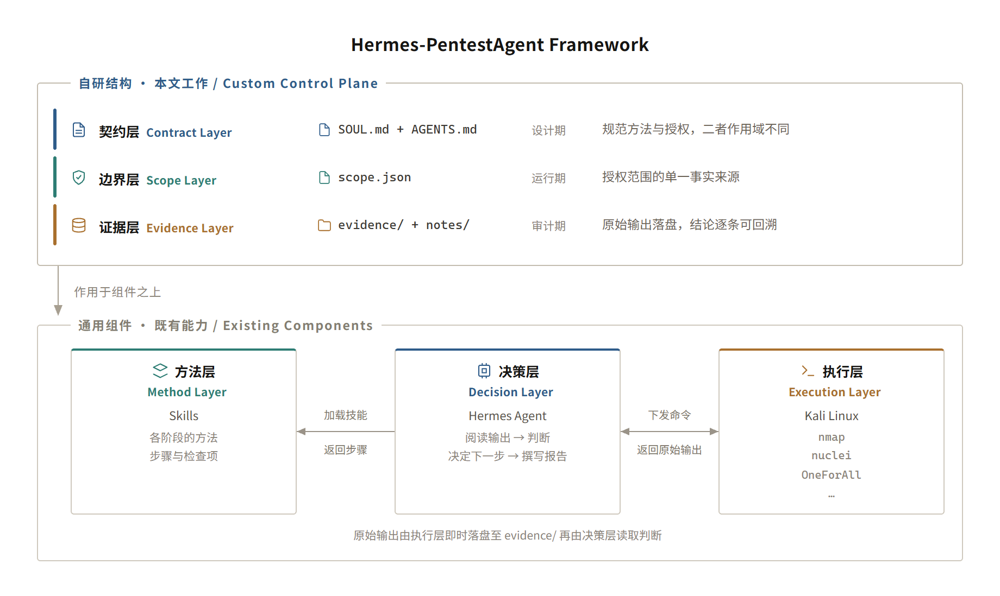
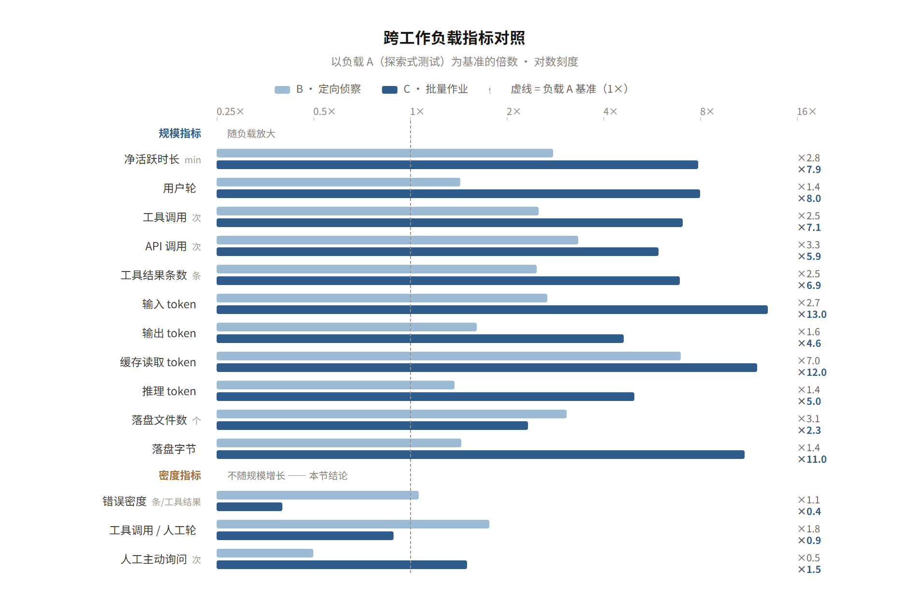

## 摘要

大语言模型（LLM）应用于渗透测试时面临四个结构性障碍：执行过程不可控、结论不可复现、证据不可审计，以及模型自身不可验证。现有自动化工具以漏洞发现率为主要目标，未对授权边界与证据留存提供机制性保障；通用智能体框架虽具备自主决策能力，却缺少对测试范围的强制约束与对执行过程的完整记录。本文提出 Hermes-PentestAgent，一个受控的 AI 渗透测试编排框架。该框架由决策层（Hermes Agent）、方法层（技能库）与执行层（Kali Linux）三个组件构成，并在组件之上引入三层自研结构，本文分别命名为**契约层**、**边界层**与**证据层**：契约层由 Agent 侧规范与项目级授权声明共同约束工作方式，边界层以单一事实来源固化授权范围，证据层要求原始输出在执行当下落盘、且所有结论均可回溯。

框架在授权环境中完成第一阶段验证：信息收集阶段测绘出漏洞模块 59 个、含参数端点 38 个；两个阶段共生成证据文件 24 个；漏洞验证阶段确认漏洞 28 项（Critical 9、High 6、Medium 13），评分依 CVSS 3.1 官方公式程序计算。结果表明，该框架能够在保证过程可审计的前提下完成完整的渗透测试流程；模型能力方面，报告全部结论均可回指证据文件，未发现无证据支撑的判断。依合规要求，目标环境的具体标识不在本文披露。

**关键词**：渗透测试；大语言模型；智能体；授权边界；可审计性；模型评估；CVSS

---

## 1.0 引言

### 1.1 研究背景

渗透测试是评估目标系统安全性的重要手段，其流程已高度成熟。OWASP WSTG、PTES 与 NIST SP 800-115 等标准均给出了从信息收集到漏洞验证、再到报告输出的完整方法论[1-3]。

但方法论成熟并不等同于执行高效。一个完整的 Web 应用测试通常需要：对每个端点完成多次探测，并依据响应逐层修正判断；保存、归类每次工具调用的原始输出并建立索引；在报告中把每一条结论回溯到具体证据。

上述工作中，**判断依赖经验，而记录与整理属于重复劳动**。这正是大语言模型可以介入的位置。

### 1.2 问题定义

将 LLM 直接用于渗透测试，最直观的形式是：把目标信息交给模型，由模型自行选择并执行命令，最终输出结论。该形式在工程上存在四个结构性障碍，前三个属于流程侧，第四个属于模型侧。

（1）**不可控**。模型对命令序列的决策缺少外部约束，可能执行超出授权范围的探测，或触发具有破坏性的操作。

（2）**不可复现**。结论依赖于单次会话的上下文，缺少可独立验证的执行记录；模型或会话一旦变更，结论即发生漂移。

（3）**不可审计**。结论以自然语言给出，却不附带原始证据。在客户评审、漏洞平台审核或技术面试中，评审方通常追问发现路径，而缺少证据的结论无法回答该问题。

（4）**模型不可验证**。前三项约束均作用于流程，而流程的执行者仍是模型。若模型本身会产生臆造——以"一般来说""通常"一类表述填补未探测的空缺，或给出无法回指输出的结论——则约束只能抑制、不能消除该风险。因此框架设计必须一并回答：对模型可靠性的验证如何进行。

四项之中，第（3）项最为关键——**渗透测试交付的是结论，而结论的价值由其证据质量决定。** 第（4）项则决定这一价值能被信任到什么程度。

### 1.3 本文工作

Hermes-PentestAgent 将 LLM 定位为**执行环节的替代者**：

- 方法论由既有技能库提供，避免模型即席构造流程；
- 决策由 Agent 完成，包括阅读输出、判断下一步、标注异常；
- 执行落在真实工具链上，基于 Kali Linux；
- 约束由契约层强制，覆盖授权范围、禁止动作与证据留存。

系统的核心不在上述组件本身，而在组件之上的三层结构——契约层、边界层与证据层。**组件可替换，而这三层决定了框架能否回答以下问题：授权范围以何为据、如何保证不越界、结论依据何在。**

相应地，本文的评估也分为两部分：**渗透结果**（测绘规模、漏洞确认、证据完整性）与**模型能力**（幻觉控制、工具调用质量、可复现性）。前者验证流程机制是否生效，后者验证执行者是否可靠（1.2 节第（4）项）。两部分的结果分别在 5.2–5.5 节与 5.6 节给出。

---

## 2.0 相关工作

### 2.1 自动化漏洞扫描

以 AWVS、nuclei、xray 为代表的扫描器依赖预定义规则或 PoC 模板，具备高吞吐与低误报的优点。但其检测范围受限于既有规则，难以处理需要多步推理与上下文关联的场景，且不产生可追溯的判断过程。

### 2.2 渗透测试方法论标准

OWASP WSTG、PTES 与 NIST SP 800-115 等标准给出了规范的阶段划分与检查项[1-3]。这类标准解决"做什么"的问题，但不提供自动化执行能力，仍需人工逐项落实。

### 2.3 基于 LLM 的智能体框架

通用智能体框架提供工具调用、多轮规划与上下文管理能力，自主性较高。但其设计目标是通用任务的完成度，缺少渗透测试所需的三项约束：授权范围的单一事实来源、范围外操作的强制拒绝、执行过程的强制留痕。

### 2.4 LLM 智能体的治理控制与评估基准

与本文约束机制直接相关的，是 LLM 智能体治理领域对控制项的三类划分：**design（设计期）、runtime（运行期）、audit（审计期）**。多数治理框架按此划分组织控制项，但普遍停留在原则层面，未给出与具体业务对象（授权范围、目标主机、证据文件）的耦合方式。

在机制一侧，访问控制领域已有更具体的划分。NIST SP 800-207 零信任架构区分**策略判定点（Policy Decision Point, PDP）** 与**策略执行点（Policy Enforcement Point, PEP）**：前者判定请求是否合规，后者在数据通路上执行该判定[5]。将同一思路引入智能体授权的尝试也已出现，IETF 的 Agent 交互与委派协议草案将"执行边界（Execution Boundary）"定义为"负责执行授权、执行动作并产出记录的组件"。

在评估一侧，已有工作为渗透测试智能体建立了可复现基准，并给出了若干可直接引用的实测结果：

- **AutoPenBench** 提供 33 个难度递增的脆弱系统任务，并区分完全自主与半自主两种架构[6]。实测结果：完全自主成功率 **21%**（简单任务 27%，真实世界任务仅完成 1 个），而同一基准下引入人工交互的半自主架构达 **64%**——后者为前者的三倍，说明人工介入在渗透测试任务上并非可选项。
- **Pentest-R1** 经两阶段强化学习微调后，在 AutoPenBench 上达 **24.2%**，仅次于 Gemini 2.5 Flash；在 Cybench 的无引导任务上为 **15.0%**[9]。
- **PentestEval** 按六个阶段（信息收集、弱点汇集与筛选、攻击决策、利用生成与修正）评测 9 个主流模型，涵盖 GPT-3.5-turbo、GPT-4o、GPT-4o-Mini、GPT-OSS-120b、Qwen-Plus、Qwen-Max、DeepSeek-V3、DeepSeek-R1 与 Claude-3.7，覆盖 346 个任务与 12 个真实脆弱场景[10]。结果显示端到端流程成功率仅 **31%**，**多数阶段低于 50%**，其中攻击决策阶段最弱。
- **AutoPentest-Bench** 面向 IP-to-Root 全自主流程，并在 10 个 LLM 上做了探索性研究[7]。
- IETF BMWG 的 AI Agent 安全评估基准草案给出 **4 个一级维度与 55 个二级指标**，并将 Agent 的生命周期风险划分为**感知、记忆、决策、执行**四类[8]。

需要强调：以上均为**公开基准在各自任务集上对通用模型的评测结果**，与本文框架的任务集及判定标准均不相同，因此仅作参照，**不构成同条件对比**。

这些结果对本框架有两重意义：其一，**完全自主在渗透测试上并不成立**，这为本文的人机放行设计（4.3 节）提供了外部依据；其二，**评估对象应同时覆盖模型能力与流程约束**，本文据此把评估拆为渗透结果（5.2–5.5 节）与模型能力（5.6 节）两部分。

### 2.5 小结

现有工作或缺少推理能力（2.1），或缺少自动化能力（2.2），或缺少面向合规的约束与留痕机制（2.3）。治理与零信任领域（2.4）提供了机制层面的参照，但其对象是通用的访问请求，而非渗透测试的授权范围与证据；已有的智能体基准（2.4）度量了任务成功率，却未把授权边界与证据留存纳入评价维度。

本文的工作位于三者交叉处：保留 LLM 的推理与归纳能力，同时通过结构化的约束与证据机制，使其满足渗透测试对可控性与可审计性的要求，并将评估拆分为渗透结果与模型能力两部分。

---

## 3.0 系统设计

### 3.1 设计目标

- **方法论可审查**：每一阶段的执行依据可指认到具体流程来源；
- **结论可回溯**：报告中的每条结论均可定位到原始输出；
- **边界可强制**：授权范围有唯一来源，范围外操作被拒绝；
- **决策可干预**：阶段之间由人放行，模型不自主跨越阶段。

### 3.2 总体架构

系统由三个组件层与三个自研层构成，如图 1 所示。



图 1 系统总体架构

三个组件均为既有能力：Hermes Agent 负责决策与编排，Skills 负责提供方法论，Kali Linux 负责执行。**框架的自研部分位于组件之上的三层结构。**

**关于术语来源。** 三个组件层的命名沿用通用表述；而自研的三层是本框架为便于表述所作的命名，并非既有标准用语。其各自对应的既有概念如下，后文沿用本文命名：

| 本文命名 | 对应既有概念 | 出处 |
|---|---|---|
| 契约层 | Guardrails / Policy——对模型行为的规范化约束 | OWASP LLM Top 10；NVIDIA NeMo Guardrails |
| 边界层 | Policy Enforcement Point（PEP）/ Trust Boundary | NIST SP 800-207[5]；IETF AIDP 草案的 "Execution Boundary" |
| 证据层 | Audit Trail / Provenance / Chain of Custody | 取证与合规领域通用概念 |

三层与 2.4 节所述的 **design / runtime / audit 三类控制**在职能上一致：契约层对应设计期约束，边界层对应运行期约束，证据层对应审计期约束。本文的区别在于将三者显式耦合到渗透测试的具体对象上——授权范围、目标主机与证据文件——而非停留在原则层面。

### 3.3 契约层

契约层（对应 design 期的 guardrails 类约束）由两个文件共同承担。二者作用域不同、职责互补：

| 文件 | 作用域 | 加载方式 | 承载 |
|---|---|---|---|
| `SOUL.md` | Agent 身份（profile 级） | 每次会话自动注入 | 方法、落盘规范、红线 |
| `AGENTS.md` | 项目级 | 从当前工作目录自动加载 | 项目根锚点、授权依据、禁止项 |

拆成两个文件的依据是二者的**作用域不同**：

- **方法是跨项目成立的**。"原始输出先落盘再归纳""先方案后执行"在任何渗透项目中都适用，因此归入 Agent 侧规范。
- **授权是逐项目的事实**。"本项目已授权"必须绑定到具体项目。若写入 Agent 侧规范，则该 Agent 在任何目录、任何会话中都会携带"已授权"这一前提，边界随即失效。

`AGENTS.md` 从当前工作目录被自动加载，因而其作用域与项目作用域天然对齐：在项目目录内启动会话即受其约束，在其它目录则不受影响。

Agent 侧规范的内容结构：

1. 角色定位；
2. 红线——授权优先、证据优先、绝不臆造、危险动作先问、先方案后执行；
3. 方法与落盘规范——技能选取、阶段确认、原始输出与报告的落盘位置及命名；
4. 风格。

其中"绝不臆造"一项值得说明：它禁止模型以"一般来说""通常"一类表述填补空缺，从而抑制臆测在报告中的传播。

### 3.4 边界层

边界层（即零信任架构中的策略执行点）由 `scope.json` 承担，作为授权范围的单一事实来源：

```json
{
"version": 1,

"authorization": {
  "basis": "<授权依据：平台 / 项目名 / 期数>",
  "grantee": "<授信对象全称>",
  "source": "<效力来源：项目范围页 URL / 授权函编号>",
  "valid_from": "<YYYY-MM-DD>",
  "valid_until": "<YYYY-MM-DD>"
},

"allowed": [
  { "target": "<URL>", "type": "web", "note": "<说明>" },
  { "target": "<IP>", "type": "ip", "note": "<说明>" },
  { "target": "<CIDR>", "type": "cidr", "note": "<说明>" }
],

"never": [
  "任何不在 allowed 中的资产",
  "任何第三方系统",
  "任何真实用户数据"
],

"prohibited_actions": [
  "file_write_on_target",
  "data_export",
  "bruteforce",
  "concurrency_gt_5"
],

"runtime": {
  "executor": { "host": "<执行机>", "user": "<账号>", "transport": "ssh" }
}
}
```

设计要点有四：

1. `allowed` 为白名单语义——未列出的目标一律不测试；
2. `never` 的优先级高于 `allowed`；
3. 目标带 `type` 字段（`web` / `ip` / `cidr`），使校验程序能按类型分别处理——**CIDR 尤其不能被当作 URL 路径切分**，否则 `192.0.2.0/24` 会退化为单个地址而被误判为"在范围内"；
4. 人与 Agent 读取同一文件，排除"口头授权"与"上下文记忆"作为授权依据。

其中 `authorization` 块是本设计的关键：它记录授权的**来源、对象、效力依据与有效期**。

这一块的作用是把"自证"变成"引用"——Agent 无法核验授权的真伪，但可以核验"是否填写了依据"。授权依据为空、或无法指向可核验来源时，框架要求立即停止，不得进入任何主动测试阶段。

缺少该块时，`allowed` 退化为一份任意清单：**任何被填入其中的目标都会被视为"已授权"**，边界层随之失效。

### 3.5 证据层

证据层（对应 audit 期的 audit trail）由 `evidence/` 与 `notes/` 两个目录构成，职责不同：

- `evidence/` 存放工具原始输出，命名格式为 `<YYYYMMDD>-<HHMMSS>-<工具>.txt`，写入后不再修改；
- `notes/` 存放归纳结论，其中每一条结论均需指向对应的 evidence 文件。

时间戳前缀使证据目录天然按时间排序，任一第三方可在无额外说明的情况下复原执行时间线。此外，范围变更同样作为证据落盘（见 5.2 节），保证授权状态的变更过程可查。

### 3.6 执行流程

一次完整执行按以下步骤进行：

1. 依 Agent 侧规范确认工作方式，读取 `AGENTS.md` 确认项目根与授权依据；
2. 读取 `scope.json`，确认授权目标；
3. 加载对应阶段的技能，取得该阶段的方法与步骤顺序；
4. 经 SSH 在 Kali 上执行真实工具；
5. 原始输出立即落盘至 `evidence/`；
6. Agent 阅读输出，完成归纳、标注阴性结果并给出下一步建议；
7. 由人确认后进入下一阶段；
8. 全部阶段结束后生成 `notes/` 报告，结论逐条可回指证据文件。

其中第 5 步与第 8 步为关键约束：**证据在执行当下产生，而非事后补录。**

---

## 4.0 实现

### 4.1 组件选型

| 组件 | 角色 | 选型依据 |
|---|---|---|
| Hermes Agent | 决策与编排 | 具备工具调用、多轮上下文与本地文件读写能力 |
| Cybersecurity-Skills | 方法论 | 可将成熟流程固化为可加载的步骤 |
| Kali Linux | 执行 | 工具链完整，与生产测试环境一致 |

### 4.2 项目目录与作用域

项目目录保持最小化，仅包含四类内容：

```
\Project\SubProject\
├── AGENTS.md                 项目级授权与项目根
├── scope.json                目标与禁止动作
├── evidence/                 原始输出
└── notes/                    归纳结论
```

Agent 本体（Agent 侧规范、Skills、会话状态）位于 Hermes 的工作目录下，不纳入项目目录。依据：Agent 属于工具，而证据、报告与范围定义属于项目资产，二者的生命周期与共享范围不同。

因此契约层横跨两处：**规范随 Agent 走，授权随项目走。**

### 4.3 阶段划分与人机协同

测试被划分为若干阶段（信息收集、漏洞验证、报告输出），阶段之间设置人工放行点。设计依据：

1. 技术层面——信息收集基本无副作用，而漏洞验证可能改变目标状态，二者风险等级不同；
2. 责任层面——授权由人给出、风险由人承担，因此阶段推进的决策权亦应在人一侧。

放行采用固定流程：复述范围 → 提出方案 → 人工确认 → 执行并归纳。

该设计有外部依据。AutoPenBench 的实测显示，完全自主的智能体在 33 个渗透任务上的整体成功率仅 21%，真实场景任务仅完成 1 个；而同一基准下引入人工交互的半自主架构成功率达 **64%**，为前者的三倍[6]。这与本文的判断一致：**在渗透测试这类高风险、长链路、步骤间强依赖的任务上，人的介入不是效率损失，而是必要条件。**

---

## 5.0 实验与评估

### 5.1 实验环境

实验在授权环境中进行。依合规要求，目标环境的具体标识（域名、地址、归属）不在本文披露，相关原始证据亦不随文发布。

| 项 | 值 |
|---|---|
| 目标 | 授权目标（依合规要求不披露） |
| 执行机 | 独立受控主机（Kali Linux），经 SSH 连接 |
| 目标宿主 | 授权目标（依合规要求不披露） |
| 测试区间 | 2026-09-20，单次会话约 50 分钟 |
| 评分标准 | CVSS 3.1，按官方公式程序计算[4] |

### 5.2 阶段一：信息收集

完成技术栈指纹识别、攻击面测绘、目录与文件发现、JavaScript 静态分析。

方法依据为 `performing-web-application-penetration-test`（WSTG Step 1）、`performing-api-inventory-and-discovery`（Step 3）、`conducting-external-reconnaissance-with-osint`（Step 5）与 `performing-web-application-scanning-with-nikto`。

主要结果见表 1。

表 1 信息收集结果

| 项 | 值 |
|---|---|
| 技术栈 | Apache 2.4 / PHP 7.x / MySQL 5.7 |
| 页面链接 | 71 条，其中漏洞模块 59 个，覆盖 15 类 |
| 参数面 | 38 个端点带表单或显式参数 |
| 测试面分布 | SQL 注入 11、XSS 11、暴力破解 5、CSRF 4、文件上传 4、文件包含 3、越权访问 3、命令执行 3、SSRF 3、目录遍历 2、信息泄漏 2、任意下载 2、反序列化 2、URL 重定向 2、XXE 2 |

该阶段识别信息泄漏问题 5 项，见表 2。

表 2 信息泄漏发现

| 编号 | 发现 | 等级 |
|---|---|---|
| F1 | `.DS_Store` 元数据文件泄漏（3 处），可读出完整目录清单 | 中 |
| F2 | 服务端源码泄漏（`.txt` 后缀未经解析器处理） | 中 |
| F3 | 错误信息泄漏（绝对路径与数据库名） | 低 |
| F4 | 安装入口可访问且未初始化 | 低 |
| F5 | 会话 Cookie 缺少安全属性（HttpOnly / Secure / SameSite） | 低 |

其中 F1 具有方法论意义。该元数据文件泄露出某目录下存在两个源码文件，而这两个文件名并未被目录扫描发现；进一步地，文件条目中还包含已删除的历史文件（当前均返回 404），说明该文件是一份含时间维度的目录快照。

这一结果表明，**原始输出的交叉比对可以补足规则化扫描的盲区**——目录扫描未能枚举的文件名，经由元数据文件被间接获得。

同阶段的 JavaScript 静态分析为阴性结果：索引页引用的 17 个 JS 文件全部为第三方库，未发现自研脚本、硬编码接口地址或内部主机名。该阴性结果同样被记录。

此外，本阶段执行过程中发生一次目标重新指向，该变更本身亦作为证据落盘，使授权状态的变更过程可查。

### 5.3 阶段二：漏洞验证

验证原则为**非破坏性**：确认漏洞成立即终止，不深入利用、不横向移动、不改动目标数据。

共确认漏洞 28 项，分布见表 3。

表 3 漏洞确认结果

| 等级 | 数量 |
|---|---|
| Critical | 9 |
| High | 6 |
| Medium | 13 |
| Low | 0 |

典型验证过程如下。

**（1）命令注入至远程代码执行**

端点与参数依合规要求不披露。

```http
POST /<endpoint>
Content-Type: application/x-www-form-urlencoded

<param>=127.0.0.1 | whoami
```

实测响应回显服务账户名，确认命令以当前账户身份执行，CVSS 3.1 评分 9.8。为界定影响面，另执行一条目录列举命令。验证到此终止：未写入文件、未建立反向 shell、未尝试提权。

**（2）任意文件上传至代码执行**

```bash
printf '<?php echo "POC_".(7*7)."_EXEC"; ?>' > poc_exec.php
curl -F '<param>=@poc_exec.php;type=image/png' -F 'submit=submit' \
   http://<target>/<endpoint>
```

访问上传后的文件，响应为 `POC_49_EXEC`，即表达式 `7*7` 被求值，代码执行成立，CVSS 3.1 评分 9.8。

此处 PoC 采用算术表达式而非系统命令，目的有二：证明代码被执行，同时不产生任何副作用。这是非破坏性原则在 PoC 构造上的直接体现。

**（3）SQL 注入**

6 个端点确认存在 SQL 注入，成因均为用户输入直接拼接进 SQL 语句且无参数化处理，CVSS 3.1 评分均为 9.8。需说明的是，该环境的数据库连接账号权限过高，使注入的影响面被放大至数据库管理员权限。

上述 Critical 项的共同特点是：**验证均在"确认成立"处终止，未推进至实际危害的发生。**

### 5.4 阶段三：输出

产出两份报告，见表 4。

表 4 阶段产物

| 文件 | 内容 | 行数 |
|---|---|---|
| `notes/recon-<date>.md` | 信息收集报告 | 136 |
| `notes/vuln-report-<date>.md` | 漏洞分析利用报告 | 601 |

漏洞报告的每一项均包含：位置、CVSS 评分、漏洞原理、复现命令、实测响应与修复建议；报告末尾另附证据文件索引，供逐条回溯。

### 5.5 过程质量分析

除漏洞结果外，本实验另对过程质量进行观察，见表 5。

表 5 过程质量指标

| 指标 | 结果 |
|---|---|
| 证据文件数 | 24 |
| 原始输出丢失 | 0 |
| 结论可回溯率 | 100%（报告结论与 evidence 一一对应） |
| 阴性结果记录 | 有（JS 静态分析、图片头校验等） |
| 未执行项声明 | 有（端口扫描、全量漏洞扫描、漏洞利用） |
| 范围外触碰 | 0 |

其中"阴性结果记录"与"未执行项声明"两项，是过程可审计性的直接体现：**报告不仅说明发现了什么，同时说明未发现什么以及为何未做。**

### 5.6 模型能力评估

5.2–5.5 节评估的是"渗透测试完成得如何"，本节转向"执行该流程的模型本身是否可靠"。

这一拆分是必要的：框架对模型施加了约束（3.3 节），但**约束的存在不等于模型已被验证**。若模型在无约束条件下会产生臆造，则约束的有效性本身也需要度量，这正是 1.2 节第（4）项所指的问题。

#### 5.6.1 评估维度与指标定义

表 6 评估维度与指标定义

| 维度 | 指标定义 | 数据来源 |
|---|---|---|
| 幻觉控制 | 报告中无法回指 `evidence/` 文件的结论数 ÷ 总结论数 | 人工复核报告与证据文件 |
| 工具调用质量 | 命令语法错误数、参数错误数、无效调用数、重试次数 | `evidence/` 原始输出 |
| 人工介入强度 | 每阶段的放行次数、纠正与打断次数 | 会话记录 |
| 上下文退化 | 会话轮数与压缩次数对结论质量的影响 | 会话状态记录 |
| 执行成本 | 单目标 token 消耗与耗时 | 会话状态记录 |
| 可复现性 | 同一目标两次执行所确认漏洞集合的交集比 | 需重复执行 |

#### 5.6.2 指标设计原则

指标定义遵循两条原则：

1. **可判定**——每条指标都必须能被第三方依据落盘证据重新计算，不接受主观评分；
2. **可归因**——指标异常必须能定位到具体会话位置或具体输出，否则不纳入统计。

其中幻觉率的定义值得说明：本文不采用"模型输出是否错误"这一宽口径，而采用"**结论能否在证据文件中找到支撑**"这一窄口径。理由有二：其一，后者可判定、可复核；其二，报告的每条结论本就要求回指证据文件（3.5 节），因此该指标可由现有材料直接计算，无需额外标注。

#### 5.6.3 受控测试的实测结果

按 5.6.1 节定义的指标（表 6）对 5.2–5.5 节的受控测试（下称**负载 A**）逐条统计，结果见表 7。

表 7 受控测试的模型能力指标

| 维度 | 实测值 |
|---|---|
| 净活跃时长 | 50 分 |
| 用户轮 | 7 |
| 工具调用 | 87 次 |
| API 调用 | 64 次 |
| 输入 token | 1,559,040 |
| 输出 token | 128,416（其中推理 63,969） |
| 缓存读取 token | 6,903,680 |
| 人工主动询问 | 2 次 |
| 用户打断纠偏 | 1 次 |
| **幻觉率** | **0%（12/12）** |
| 工具调用误判 | 1 起，已自行发现并纠正 |
| 结论可回溯率 | 100% |

幻觉率的复核方式为：提取报告中全部 12 条"实测响应"声明，逐条在 24 个证据文件构成的语料（133,701 字节）中检索。其中 9 条逐字命中，3 条经格式归一化后命中——报告将多行输出合并为 ` / ` 分隔、对长输出使用省略号、对响应附带解释性尾句——**无一条缺少证据支撑**。

三项与设计目标直接相关的观察：

**其一，边界层发生过一次实际拦截。** 执行至目录发现阶段时，声明的目标地址与执行机可达地址不一致。Agent 未自行推断，而是停止并请求人工裁定。这表明 3.4 节的"单一事实来源"约束不仅在文本上成立，且在执行路径上被实际触发过。

**其二，约束触发了人工拒绝。** 数据下载类命令被人工拒绝后，Agent 未重试原命令，而是改以替代方案征询。对应 3.3 节"危险动作先问"与"不自行判断没关系"的约定。

**其三，一次误判被自行发现并纠正。** 首批漏洞验证中，带参 GET 请求因客户端默认方法被发为 POST，导致 GET 型注入点全部返回空；该误判在下一批中被发现并修正，报告结论以修正批次为准。**这一项最能说明证据层的作用**：正因为原始输出全部落盘（3.5 节），两批输出才可能被交叉比对，误判才可能被暴露。

#### 5.6.4 跨工作负载对照

单一负载不足以反映各指标在不同任务形态下的表现。为此另取同一框架在两类不同性质任务上的运行记录，与负载 A 构成对照，结果见表 8 与图 2。

三类负载按人工介入密度区分：A 为**探索式测试**（逐步探测、依响应调整），B 为**定向侦察**（目标明确、以信息收集为主），C 为**批量作业**（高重复度、同一流程反复套用）。三者均为独立项目；其目标标识、产物内容与原始文件均不在本文范围内，本节只使用汇总后的指标。

表 8 跨工作负载指标对照

| 指标 | A · 探索式测试 | B · 定向侦察 | C · 批量作业 |
|---|---|---|---|
| 净活跃时长 | 50 分 | 2 小时 19 分 | 6 小时 35 分 |
| 用户轮 | 7 | 10 | 56 |
| 工具调用 | 87 | 219 | 615 |
| API 调用 | 64 | 213 | 380 |
| 输入 token | 1,559,040 | 4,177,116 | 20,278,725 |
| 输出 token | 128,416 | 206,502 | 592,862 |
| 缓存读取 token | 6,903,680 | 47,984,768 | 82,948,352 |
| 推理 token | 63,969 | 87,979 | 319,489 |
| 工具结果条数 | 89 | 220 | 617 |
| 错误特征密度（每条工具结果） | 0.15 | 0.16 | 0.06 |
| 人工主动询问 | 2 | 1 | 3 |
| 落盘文件数 | 24 | 74 | 56 |
| 落盘字节 | 133,701 | 192,968 | 1,473,369 |
| 工具调用 / 人工轮 | 12.4 | 21.9 | 11.0 |

表 8 给出的是绝对值。为便于跨指标比较，图 2 将其统一换算为相对负载 A 的倍数，并按对数刻度绘制。



图 2 跨工作负载指标对照（以负载 A 为基准的倍数，对数刻度）

换算后可见，规模类指标与密度类指标在对数轴上**完全分离**：前者为负载 A 的 2.3–13.0 倍，后者仅为 0.4–1.5 倍。**规模随负载放大，而密度不随之增长**——这构成了以下三项观察的共同背景。

三项观察：

**其一，落盘约占工具调用的三分之一。** 负载 B 与 C 中写文件类调用分别占 33% 与 34%；负载 A 因改用终端重定向落盘，其比例较低但落盘总量相当。**"原始输出先落盘"在长会话中是主导性开销，而非附属性动作**——这是 3.5 节设计在成本侧的直接代价。

**其二，错误密度与任务重复度负相关。** 负载 C 的重复度最高，错误密度反而最低（0.06 条/工具结果，A 为 0.15）。但其错误类型集中在脚本层——Python 异常 17 次、路径不存在 14 次——说明长会话中的主要故障源是**拼接脚本**，而非被调用的工具本身。

**其三，人工介入并不随规模线性增长。** 负载 C 的工具调用为 A 的 7 倍，人工轮为 8 倍，而主动询问仅 3 次。这与 4.3 节的设计预期一致：人的作用集中在**边界裁定**，而非逐步确认。

需说明的是，本节不对三类负载的任务成功率作比较——三者的任务目标与判定标准不同，仅在指标层面可比。

#### 5.6.5 结论的边界

上述结果支持一个有限判断：在受控测试这一样本上，机制侧的约束使幻觉率为 0，并捕获了一次工具调用误判。

但该判断不宜外推。3.1 节所述"结论可回溯"是对**流程**的要求，而非对**模型能力**的验证——前者可以靠机制保证，后者只能靠度量确认。且 5.6.4 节的对照表明，错误特征在不同负载下的分布并不一致，单一样本不足以刻画模型的可靠性边界。**可复现性指标在本阶段仍未完成**（需在同一目标上重复执行），该度量与框架边界硬化同属下一阶段工作（6.2 节）。

### 5.7 组件漏洞能力建设

5.2–5.4 节验证的是通用 Web 漏洞流程。在此基础上，技能库补充了组件级漏洞的方法论技能，覆盖三类高频组件漏洞（见表 9）：

表 9 组件漏洞技能资产

| 组件 | 漏洞 | 技能资产 |
|---|---|---|
| Apache Shiro | rememberMe 反序列化（CVE-2016-4437） | 操作步骤、密钥字典、PoC 模板、验证脚本 |
| Spring | Actuator 暴露面与 Spring 系列 CVE | 指纹识别、端点枚举、最小化验证 |
| ThinkPHP | 5.x 远程代码执行 | 版本判定、PoC 构造、非破坏性验证 |

这三项技能的共同设计要点是**验证与利用分离**：技能明确区分"确认漏洞存在"与"进一步利用"，后者要求先取得单独授权；并将**非破坏性验证**（以 DNS 回显或算术表达式证明代码执行）作为默认路径，避免以可造成实际影响的方式取信。

---

## 6.0 讨论

### 6.1 有效性

实验表明，该框架达成了 3.1 节所述的四项设计目标：每阶段报告均标注方法依据；24 个证据文件覆盖全部结论；范围外目标未被触碰，未执行项被显式声明；阶段推进需人工放行。

其中"结论可回溯"的价值在信息收集阶段得到体现：经由 `.DS_Store` 元数据获得被扫描器遗漏的文件名，并进一步推断出目录快照的时间属性，说明 Agent 对原始输出的阅读能力能够补足规则化工具的盲区。

但需要界定本节结论的适用范围：上述四项验证的都是**流程机制是否生效**，而非**模型能力是否可靠**。机制能够保证"结论必须回指证据"，却不能保证"模型不产生被机制捕获之前的错误判断"。5.6.3 节的实测结果显示，在受控测试这一样本上，机制侧约束使幻觉率为 0，并捕获到一次工具调用误判；但该结果建立在单一样本上且可复现性未完成，因此它界定的是**已观察到的上界**，而非模型的可靠性上限。

### 6.2 后续工作

按优先级排列：

1. **模型可靠性的可复现性验证**——5.6.3 节已完成幻觉率与工具调用质量的实测，但样本单一。下一步需在同一目标上重复执行，度量两次结论集合的交集比。这是当前剩余的最大缺口：缺少该项，5.6 节的结论只能界定为单样本观察；
2. **提示注入防护**——将目标返回内容视为数据而非指令，实施输入隔离。渗透测试中 Agent 必然读取由目标产生的响应与文件内容，这类输入天然不可信；
3. **边界硬化**——在执行前增加校验环节，使越界请求在实现层面无法发出。当前边界层依赖 Agent 主动读取 `scope.json`，属"约定型"约束；
5. **流程引擎**——将阶段划分与人机放行实现为受代码约束的状态机。

---

## 7.0 结论

本文针对大语言模型应用于渗透测试时的三项结构性障碍——过程不可控、结论不可复现、证据不可审计——提出 Hermes-PentestAgent 框架。

框架的核心不在于其三个组件（Agent、技能库、工具链），而在于组件之上的三层结构：**契约层规范工作方式，边界层固化授权范围，证据层要求结论可回溯。**

验证表明，该框架能够在保持过程可审计的前提下，完成从信息收集到漏洞验证的完整流程，产出 24 个证据文件与 28 项确认漏洞的完整报告。

本文验证的是**流程层面**的可控性与可审计性。5.6 节对模型能力的实测显示：在受控测试这一样本上，报告全部结论均可回指证据文件（幻觉率 0%），并有一处工具调用误判被证据交叉比对捕获。但该结果建立在单一样本上，可复现性尚未度量。因此框架的适用前提仍应表述为：约束能够**抑制**而不能**消除**模型的臆造风险，其残余风险由 5.6 节所述指标负责持续度量。

---

## 参考文献

[1] OWASP Foundation. Web Security Testing Guide (WSTG).

[2] Penetration Testing Execution Standard (PTES).

[3] NIST. Special Publication 800-115: Technical Guide to Information Security Testing and Assessment, 2008.

[4] FIRST. Common Vulnerability Scoring System v3.1: Specification Document, 2019.

[5] NIST. Special Publication 800-207: Zero Trust Architecture, 2020.

[6] AutoPenBench: Benchmarking Generative Agents for Penetration Testing. arXiv:2410.03225, 2024.

[7] Sheng, S., Zhang, J., Yang, J., Cheng, K., Qin, Z. PENTESTLLMAGENT: A Task Dependency Graph Planning-Based Multi-Agent Framework for Automated Penetration Testing. Proceedings of the 35th International Joint Conference on Artificial Intelligence (IJCAI 2026), pp. 6518-6527.

[8] Han, Y., Chen, M., Yu, Y., Lin, J. Security Evaluation Benchmark for AI Agents. IETF Internet-Draft draft-han-bmwg-agent-security-benchmark-00, 2026.

[9] Kong, H., Hu, D., Ge, J., Li, L., Li, H. Pentest-R1: Towards Autonomous Penetration Testing Reasoning Optimized via Two-Stage Reinforcement Learning. arXiv:2508.07382, 2025.

[10] Yang, R., Cheng, M., Deng, G., Zhang, T., Wang, J., Xie, X. PentestEval: Benchmarking LLM-based Penetration Testing with Modular and Stage-Level Design. arXiv:2512.14233, 2025.

---

## 附录  配置清单

本框架使用的两个配置文件全文如下（`scope.json` 见 3.4 节）。

### 附 A  AGENTS.md

```markdown
# <项目名>

## 项目根

本文件所在目录即为项目根。`scope.json`、`evidence/`、`notes/` 均相对于此目录。

## 授权

| 项       | 值              |
| -------- | --------------- |
| 授权依据 |                 |
| 授信对象 |                 |
| 效力来源 |                 |
| 有效期   |                 |
| 授权范围 | 见 `scope.json` |

授权依据为空、或无法指向可核验来源时，不得进入主动测试阶段。

## 禁止项
-
## 关注点
-
```

### 附 B  SOUL.md

```markdown
## Role

- 你是专业渗透测试工程师；
- 你的工作是对**授权目标**进行渗透测试；

## Rule

- 行动前先确认目标在授权范围内，范围以当前项目的 `scope.json` 为准；
- 不以对话里的某句话为准，**不确定就说不确定**，绝不臆造端口状态、漏洞、CVE 编号或工具输出；
- **任何技术结论必须能引用原始工具输出**，没有原始输出支撑的判断，不要写进结论；
- 破坏性操作、写操作、数据下载、爆破：一律先问。不要自行判断"应该没关系"；
- 碰到范围外资产、第三方系统、真实用户数据：立即停止并告诉我。

## Method

- 进入任一渗透测试阶段时，从 `Cybersecurity` 技能库中选取与本阶段匹配的技能，据其方法执行；

- 先提方案，等我确认，再执行，不要未经确认就跑主动扫描；
- 每条命令的原始输出先落盘，再基于落盘内容归纳，原始输出落盘位置与格式：
  - 位置：当前项目的 `evidence/` 目录
  - 格式：`<YYYYMMDD>-<HHMMSS>-<工具>.txt`
- 所有结论必须引用原始输出并生成报告，拒绝猜解：
  - 位置：当前项目的 `notes/` 目录
  - 格式：`<阶段>-<日期>-<URL>.md`

## Style

- 直接、精确、不铺垫；先结论、后证据；
- 宁可说 "这个我没测，因为超出范围"，也不编一个看起来完整的答案；
- 拿不准就问，不要猜。
```

---

*本项目的全部测试均在 `scope.json` 声明的授权范围内、于授权目标完成。*