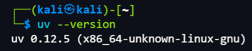
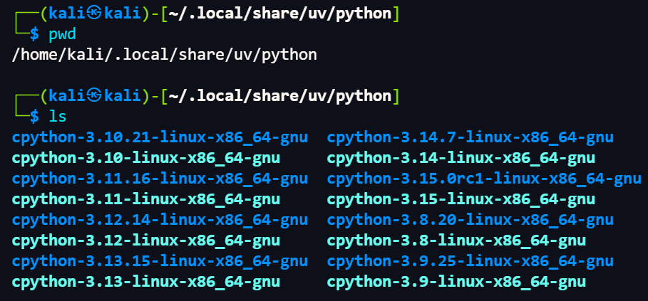
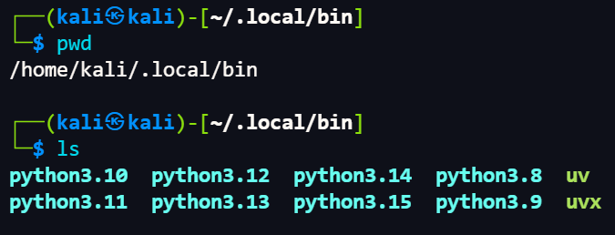
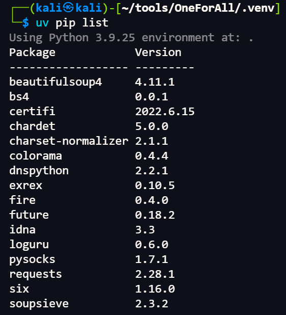
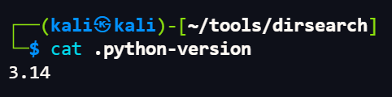
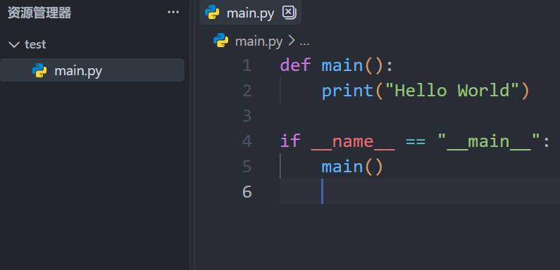
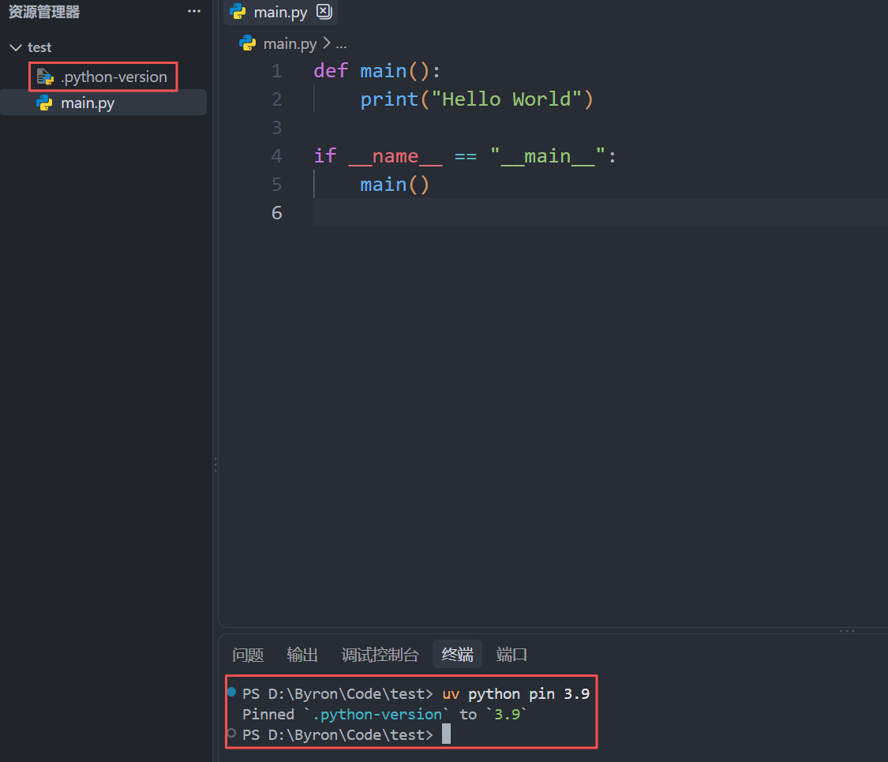
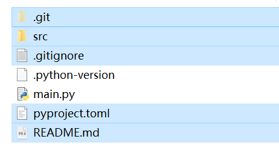
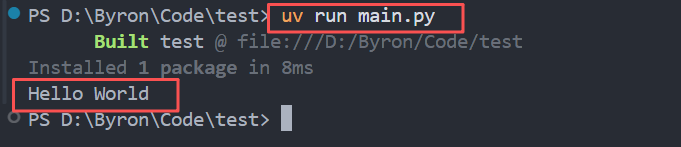
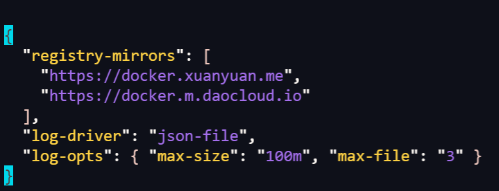

> Environment: Kali Ubuntu Windows

---

> 摘要: 本文详细分析当下工具集最优管理链路, 从原理到实战部署, 0到1完整复现

## 1.0 uv管理Python

#### 1.1 为什么选择uv?

- 极速: Rust内核, 比传统pip快10倍以上
- 多版本切换平滑
- 强隔离性, 项目环境独立
- 兼容性: 完全兼容pip
- 跨平台: Linux / macOS / Windows 

#### 1.2 uv安装

> 备注:  以下操作演示均在Linux-Kali

```bash
# On macOS and Linux.
curl -LsSf https://astral.sh/uv/install.sh | sh
```

```bash
# On Windows.
powershell -ExecutionPolicy ByPass -c "irm https://astral.sh/uv/install.ps1 | iex"
```

> 网络问题可以考虑代理或二进制安装方式

```bash
# 验证是否正确安装
uv --version
```



---

#### 1.3 uv安装python

```bash
# 查看可用版本
uv python list

# 安装指定版本
uv python install 3.10
# 多版本安装
uv python install 3.10 3.11 3.12 ...

# 查看已安装版本
uv python list --only-installed
```

---

#### 1.4 uv中的Python管理

```bash
# Python解释器本体安装位置
/home/kali/.local/share/uv/python/
```



> Python解释器本体默认在该目录

```bash
# 二进制软连接位置
/home/kali/.local/bin/
```



> 以上uv主程序和uvx(uv的软连接) 及Python软连接(指向实际解释器位置)

---

#### 1.5 uv指令集

```bash
# 基础python模块
uv --version                     # 查看版本
uv python list                   # 查看可下载Python版本
uv python list --only-installed  # 查看本地已安装好的uv托管Python
uv python install 3.9 3.10 3.12  # 一次性安装多版本
uv python uninstall 3.9          # 卸载某个版本
uv python pin 3.12               # 在项目目录锁定本项目使用Python版本, 生成 => <.python‑version>
uv python show                   # 查看当前项目锁定的Python版本

# 项目管理模块
uv init                          # 项目初始化, 生成pyproject.toml
uv venv                          # 创建虚拟环境(读取 .python‑version, 使用pin锁定的版本)
uv pip list                      # 列出当前虚拟环境已安装包
uv add requests numpy            # 添加依赖(写入pyproject.toml, 同步锁定uv.lock)
uv remove requests               # 卸载包
uv sync                          # 安装pyproject.toml/lock里全部依赖(克隆别人项目用)
uv lock --upgrade                # 更新全部依赖到允许的最新版本
uv pip freeze > requirements.txt # 导出依赖requirements.txt
uv pip install -r requirements.txt # 从requirements.txt安装
uv run main.py                   # 运行程序
```

#### 1.6 uv实战

##### 案例1:

> 基于uv部署OneForAll
>
> 备注: 该项目非uv构建, 采用`requirements.txt`文件依赖

01 项目下载

```bash
git clone https://gitee.com/shmilylty/OneForAll.git
```

> OneForAll 官方推荐 ≤ 3.9, 依赖库 `aiodns` 在高版本有兼容问题

02 Python版本指定

```bash
# 切换到 OneForAll 工具目录 /home/kali/tools/OneForAll
uv python pin 3.9
```

> 此时项目目录下会生成文件`.python-version`


03 虚拟环境创建

```bash
# 虚拟环境创建
uv venv
```

04 依赖导入

```bash
uv pip install -r requirements.txt
uv pip list # 查看项目依赖
```



05 项目运行

```bash
uv run oneforall.py --target www.xxx.com run
```

> 注意: uv运行项目激活虚拟环境非必须
>
> `uv run`会自动化查找当前目录下`.venv`并使用解释器, 无需手动激活

---

##### 案例2:

> 基于uv部署dirsearch [源码方案]
>
> 最新源码包含`pyproject.toml`可实现快速部署

01 Python版本指定

```bash
uv python pin 3.14
```



02 项目构建

```bash
uv sync
```

> 一行命令即可构建整个项目

03 项目运行

```bash
uv run dirsearch.py -u http://xxx -e*
```

---

##### 案例3:

> 手动项目实战

**流程:**

- 本地新建项目`test`写入`main.py`

  

- 绑定Python版本

  ```bash
  uv python pin 3.9
  ```

  

  > 指定python版本后自动生成`.python-version`

- 项目初始化

  ```bash
  uv init
  ```

  

  > 生成如上文件(选中部分)

- 创建虚拟环境

  ```bash
  uv venv
  ```

- 运行main.py

  ```bash
  uv run main.py
  ```

  

- 验证代码分发流程

  - 删除`.venv`内容 → 获得源码
  - 对获取的源码执行`uv sync` → 自动创建虚拟环境和依赖构建(基于`pyproject.toml` `uv.lock`)

**补充:**

- 虚拟环境
  - 激活: `source .venv/bin/activate`
  - 关闭: `deactivate`
  - 运行程序: `python xxx.py`

---

## 2.0 Docker 容器管理

#### 2.1 为什么选择Docker?

- 环境隔离
- 轻量
- 快速
- 可移植性

#### 2.2 Docker 部署

> 备注:  以下操作演示均在Linux-Kali, 与Ubuntu部署有细微差距

01 安装依赖

```zsh
sudo apt update
sudo apt install -y ca-certificates curl gnupg
# >> ca-certificates: HTTPS 通信所需的 CA 证书包, 没有它 curl 无法验证 SSL
# >> curl: 下载 GPG 密钥和后续操作的网络工具
# >> gnupg: GPG 密钥管理工具, 用于将下载的密钥转换为 apt 可识别的格式
```

02 创建密钥目录

```zsh
sudo install -m 0755 -d /etc/apt/keyrings
# >> /etc/apt/keyrings/ 是 Debian 12+ 推荐的 GPG 密钥存放目录
# >> -m 0755: 目录权限 rwxr-xr-x (所有者可写, 其他人只读)
# >> -d: 仅创建目录, 不复制文件
```

03 下载GPG密钥

```zsh
curl -fsSL https://mirrors.aliyun.com/docker-ce/linux/debian/gpg -o /tmp/docker.gpg
# >> -f: 失败时静默退出 (不输出 HTML 错误页面)
# >> -s: 静默模式 (不显示进度条)
# >> -S: 配合 -s 使用, 出错时仍显示错误信息
# >> -L: 跟随 HTTP 重定向
# >> 从阿里云镜像下载 Docker 官方 GPG 公钥 (ASCII  armored 格式)
# >> 这个密钥用于验证后续从 Docker 源下载的包是否被篡改
```

04 转换密钥格式

```zsh
sudo gpg --dearmor -o /etc/apt/keyrings/docker.gpg /tmp/docker.gpg
# >> --dearmor: 将 ASCII armored 格式 (.asc) 转换为二进制格式 (.gpg)
# >>   apt 只认二进制格式的 GPG 密钥, ASCII 格式会报错
# >>   这是最容易踩坑的一步, 很多人忘了 dearmor 导致 apt update 报
# >>   "NO_PUBKEY" 或 "invalid signature" 错误
# >> 输入: /tmp/docker.gpg (ASCII 格式)
# >> 输出: /etc/apt/keyrings/docker.gpg (二进制格式)
```

05 设置密钥权限

```zsh
sudo chmod a+r /etc/apt/keyrings/docker.gpg
# >> a+r: 所有用户可读 (apt update 以 _apt 用户身份运行, 需要读权限)
# >> 如果不设置, apt update 会报 "Permission denied" 无法读取密钥
```

06 临时文件清理

```zsh
rm -f /tmp/docker.gpg
# >> -f: 文件不存在也不报错
# >> 清理步骤 03 下载的 ASCII 格式临时文件, 已不需要
```

07 写入Docker镜像源

```zsh
echo "deb [arch=$(dpkg --print-architecture) signed-by=/etc/apt/keyrings/docker.gpg] https://mirrors.aliyun.com/docker-ce/linux/debian bookworm stable" | sudo tee /etc/apt/sources.list.d/docker.list

# >> 拆解这条命令:
# >> deb                          → 二进制包源 (区别于 deb-src 源码包)
# >> [arch=$(dpkg --print-architecture)]  → 自动检测 CPU 架构
# >>   amd64 / arm64 / armhf 等, 避免在 ARM 设备上拉 x86 包
# >> signed-by=/etc/apt/keyrings/docker.gpg  → 指定验证此源的 GPG 密钥
# >>   精确绑定: 只有用这个密钥签名的包才被信任, 防止中间人攻击
# >> https://mirrors.aliyun.com/docker-ce/linux/debian  → 阿里云 Docker CE 镜像
# >> bookworm                     → Debian 12 代号, Kali 基于 Debian, 必须用这个
# >> 不要用 jammy (Ubuntu 22.04) 或 noble (Ubuntu 24.04), 会报 Release file not found
# >> stable                       → 稳定版通道 (另有 test / nightly 通道)
# >>
# >> | sudo tee ...               → 用 tee 写入需要 root 权限的文件
# >>   比 sudo echo "..." > file 更可靠 (后者重定向不受 sudo 保护)
```

08 验证源

```zsh
cat /etc/apt/sources.list.d/docker.list
# >> 确认写入内容正确, 应该看到一行 deb 开头的源地址
# >> 如果有拼写错误或换行问题, 后续 apt update 会失败
```

09 刷新apt缓存

```zsh
sudo apt update
# >> 从新添加的 Docker 源下载包索引
# >> 如果这一步报错, 99% 是以下原因之一:
# >>   1. GPG 密钥未 dearmor (步骤 04)
# >>   2. 密钥权限不对 (步骤 05)
# >>   3. 源地址中的发行版代号错误 (步骤 07)
# >>   4. 网络不通 / 阿里云镜像暂时不可用
```

10 安装Docker

```zsh
sudo apt install -y docker-ce docker-ce-cli containerd.io docker-buildx-plugin docker-compose-plugin
# >> 五个包的作用:
# >>
# >> docker-ce              → Docker 引擎本体 (Community Edition)
# >> docker-ce-cli          → Docker 命令行客户端 (docker 命令)
# >> containerd.io          → 容器运行时 (Docker 底层实际干活的组件)
# >> docker-buildx-plugin   → 多架构镜像构建工具 (docker buildx 命令)
# >> docker-compose-plugin  → Compose V2 插件 (docker compose 命令, 空格写法)
```

11 启动Docker

```zsh
sudo systemctl enable docker    # 开机自启
sudo systemctl start docker     # 立即启动
# >> enable: 创建 systemd 软链接, 开机自动启动 docker.service
# >> start:  立即启动 Docker 守护进程 (dockerd)
```

12 免sudo配置

```zsh
sudo usermod -aG docker $USER
# >> -a: append 追加 (不覆盖已有组)
# >> -G docker: 将当前用户加入 docker 组
# >> $USER: 当前登录用户名 (kali)
newgrp docker                   # 当前终端立即生效
```

13 配置镜像加速 & 日志限制

```zsh
sudo mkdir -p /etc/docker
sudo tee /etc/docker/daemon.json << 'EOF'
{
  "registry-mirrors": [
    "https://docker.xuanyuan.me",
    "https://docker.m.daocloud.io"
  ],
  "log-driver": "json-file",
  "log-opts": { "max-size": "100m", "max-file": "3" }
}
EOF
```

14 重启生效

```zsh
sudo systemctl daemon-reload    # 重载 systemd 配置
sudo systemctl restart docker   # 重启 Docker 使 daemon.json 生效
```

15 验证

```zsh
docker version                  # 查看 Client + Server 版本信息
docker compose version          # 确认 Compose V2 插件已安装
docker run --rm hello-world     # 拉取并运行测试容器, --rm 运行完自动删除
```

---

#### 2.3 关键配置文件详解

`/etc/docker/daemon.json`



```json
{
  "registry-mirrors": [                              // 镜像加速
    "https://docker.xuanyuan.me",                    // 加速地址1
    "https://docker.m.daocloud.io"                   // 加速地址2(备用)
  ],
  "log-driver": "json-file",                         // 日志驱动
  "log-opts": { "max-size": "100m", "max-file": "3" }// 单个文件最大 100MB, 最多3个
}
```

```zsh
docker info  # 查看生效配置
```

---

#### 2.4 Docker使用

##### 1.0 镜像管理

```zsh
docker pull 镜像作者/镜像名:版本  # 镜像下载
docker pull 镜像名              # 镜像下载简化版(默认下载官方)
docker images                  # 列出本地镜像
Docker rmi 镜像ID               # 删除镜像
```

##### 2.0 容器管理

- 容器查看

  ```zsh
  docker ps                      # 查看运行中的容器
  docker ps -a                   # 查看所有容器
  ```

- 容器创建

  `docker run`

  - -d 后台运行

  - -p 80:80 端口映射(宿主机:容器端口)

  - --name xx (容器名)

  - 案例

    ```zsh
    docker run -d -p 80:80 --name mydvwa vulnerables/web-dvwa
    ```
    > vulnerables/web-dvwa 镜像名 | 也可使用镜像ID

- 容器停止

  ```zsh
  docker stop 容器ID
  ```
  
- 容器启动

  ```zsh
  docker start 容器ID
  ```

- 容器删除

  ```zsh
  docker rm 容器ID
  docker rm -f 容器ID # 强制删除
  ```

- 进入容器

  `docker exec`

  - -i 交互式

  - -t 终端分配

  - /bin/bash (/bin/bash 解释器启动)

  - 案例

    ```zsh
    docker exec -it f6e351f39c79 /bin/bash
    ```

- 容器日志查看

  ```zsh
  docker logs 容器ID
  docker logs -f 容器ID # 实时跟踪
  ```

- 多容器启动

  `docker-compose up`

  - -d 根据docker compose.yml启动整套环境
  - docker compose down关闭并移除整套环境 
