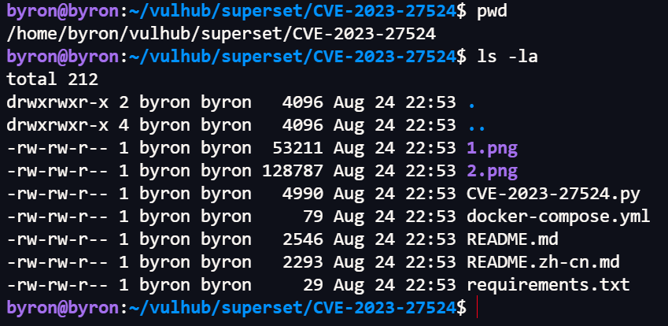
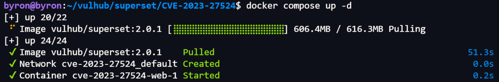

> Environment: Ubuntu 22.04 Docker

> Lab: Vulhub

---

## 1.0 靶场搭建

01 官方网址

```http
https://vulhub.org/zh
```

02 仓库克隆

```http
git clone https://github.com/vulhub/vulhub.git
# 临时代理
HTTP_PROXY=http://ip:port HTTPS_PROXY=http://ip:port git clone https://github.com/vulhub/vulhub.git
```

## 2.0 靶场下载

案例: CVE-2023-27524

```bash
/vulhub/superset/CVE-2023-27524
```



使用docker拉取靶场

```bash
docker compose up -d
```

#### 网络问题解决方案:

- 执行`docker compose up -d`时, 由于国内网络问题, 导致镜像pull失败, 返回` connection reset by peer  `

-  **HTTP** 代理

  > 写入以下内容

  ```bash
  /etc/systemd/system/docker.service.d/http-proxy.conf
  [Service]
  Environment="HTTP_PROXY=http://ip:7897"
  Environment="HTTPS_PROXY=http://ip:7897"
  Environment="NO_PROXY=localhost,127.0.0.1,10.0.0.0/8"
  ```

  ```bash
  # 配置重载
  sudo systemctl daemon-reload
  sudo systemctl restart docker
  ```

  

  > 成功pull image 
  >
  > 备注: 配置代理需清空daemon.json第三方镜像源
